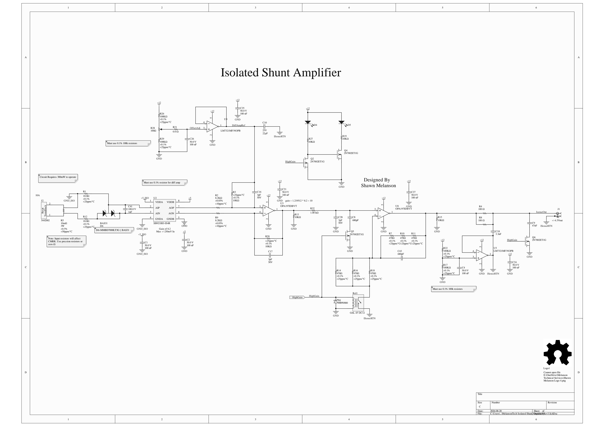
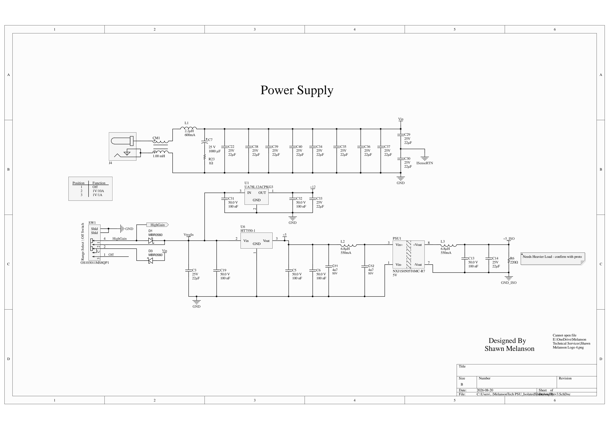

# MelansonTech Isolated Shunt Amplifier

An open-source isolated current-sense amplifier, built around the Skyworks **Si8921** isolated
amplifier and a 10 mΩ four-terminal Kelvin shunt. It measures current in a circuit sitting at a
high common-mode potential and hands you a ground-referenced signal your scope or DAQ can
read safely.

A front-panel switch selects off, the **10 A range** (gain ×10, 1 V per 10 A) or the **5 A range**
(gain ×100, 1 V per 1 A). The switch legends are scale factors, not limits — the ×100 range is a
finer range over a smaller span, running to 5 A where the 5 V output ceiling stops it. The board runs from a single 15 V isolated supply and
generates its own isolated rail for the measured side.

> ### ⚠ Power it from an isolated supply, 15 V nominal
>
> `ISenseRTN` — the output return, on the SMA shell — is **bonded to chassis**, and the board's
> internal 0 V rail floats about 6 V below it. The 15 V auxiliary input connects to that
> floating rail, so the supply **must not bond its negative output to earth**.
>
> **Fine:** a two-pin double-insulated wall adapter; a bench PSU with genuinely floating outputs.
> **Not fine:** anything USB- or PoE-derived; a bench PSU with the negative terminal strapped to
> the earth post; one supply shared between two boards.
>
> Getting this wrong shorts the reference buffer to earth — the measurement collapses and the
> part overheats. Nothing about it is visible from the outside, so check before you power up.
>
> Also: the output source impedance is 50 Ω, so a 50 Ω *terminated* instrument reads **half** the
> true output. Use a 1 MΩ input.

**On the supply voltage.** The board runs anywhere in 13–15 V, but the +12 V rail only regulates
above about **14.9 V** — the UA78L12 needs 14.5 V and there is a Schottky in the path. Below that
the rail sags and takes the 6 V reference with it.

Accuracy survives this: `DiffAmpRef` and `ISenseRTN` come from identical dividers off the same
rail, so they move together and cancel, and gain is set by resistor ratios and the Si8921 on the
regulated +5 V. What shrinks is **output headroom** — at 13 V there is 5.32 V of swing against
the 5.0 V the 5 A range needs at full scale, a 6 % margin. Run it at 15 V and the margin is 0.85 V.

Do not exceed **15.6 V**: `Rel1`'s coil is driven from the input, and that is 130 % of its rating.

## Specifications

| Parameter | Value | Notes |
|---|---|---|
| 10 A range (gain ×10) | **10 A** max | switch position 2 — 1 V per 10 A, so 1.0 V at 10 A |
| 5 A range (gain ×100) | **5 A** max | switch position 3 — 1 V per 1 A, so 5.0 V at 5 A |
| Sense resistor | 10 mΩ, 3 W, ±0.5 %, ±50 ppm/°C | Vishay WSL3637R0100DEA, 4-terminal |
| Shunt voltage at max current | 100 mV (10 A) / 50 mV (5 A) | ±250 mV maximum at the isolator input |
| Isolator gain | 8.2 (fixed) | Si8921BD-IS4R |
| Total gain | ×10 or ×100 | relay-switched second stage |
| Bandwidth, ×10 (10 A range) | ≈500 kHz † | set by the Si8921, not by an on-board RC |
| Bandwidth, ×100 (5 A range) | ≈30–60 kHz † | set by `C8` and `C9`, switched with the range |
| Full-scale output | 1.0 V (10 A range) / 5.0 V (5 A range) | `IsenseOut` relative to `ISenseRTN` (chassis) |
| Maximum output | 5 V | note: `J1` is silkscreened ±4.5 V — see the design review |
| Output impedance | 50 Ω | `R4 ∥ R8` — use a 1 MΩ input, not 50 Ω |
| Output connector | SMA female, edge launch | Cinch 142-0701-801 |
| Input common-mode range | 400 Vdc | limited by the `J2` terminal block rating |
| Isolation rating | 4.2 kV (Si8921 and PSU1) | withstand rating, not continuous working voltage |
| Accuracy, 10 A range † | ±(1.0 % of reading + 12 mA) | at 23 °C ±5 °C. Typical ±(0.6 % + 9 mA) |
| Accuracy, 5 A range † | ±(0.9 % of reading + 8 mA) | at 23 °C ±5 °C. Typical ±(0.6 % + 5 mA) |
| Temperature coefficient † | ±(0.011 % of reading + 0.5 mA)/°C | outside 23 °C ±5 °C |
| Accuracy, user gain calibrated † | ±(0.25 % + 12 mA) / ±(0.15 % + 8 mA) | requires a scale factor in your own system |
| Operating temperature | 0 °C to 40 °C | accuracy specified at 23 °C ±5 °C |
| Auxiliary supply | **13–15 V**, isolated/floating, ~300 mW | 15 V nominal. 2.1 × 5.5 mm barrel jack, centre positive |
| Supply for full specified performance | **14.9–15.6 V** | below 14.9 V the +12 rail is unregulated — see the note |
| Input connector | 2-pos 5.08 mm terminal block | Phoenix 5442002, 12 A / 400 V |
| Output reference | `ISenseRTN`, bonded to chassis | board 0 V floats ~6 V below chassis |

† Derived from the schematic, BOM and device datasheets; still to be confirmed on the bench. The
full working model is in [`docs/Tolerance Budget - Isolated Shunt Amplifier Rev 2.xlsx`](docs/).

**On accuracy.** The spec is given as ±(% of reading + fixed mA) because the two behave
differently. The proportional part comes from the shunt's ±0.5 % initial tolerance and the
isolator's ±0.2 % gain error; measuring one known current and applying a scale factor in your own
DAQ removes both and takes it to ±0.2 %. The fixed part is *not* un-nulled offset — `R28` zeroes the static offset
completely, and it is excluded from these figures. What remains is what zeroing cannot reach:
drift appearing after the trim, Si8921 nonlinearity (not an offset at all), and the finite
resolution of the pot. Because it does not shrink with the reading, below about a third of range
the error as a percentage of reading climbs past 1 %:

| Reading | 10 A range, typical | 5 A range, typical |
|---|---|---|
| Full scale | ±66 mA (0.66 % of reading) | ±32 mA (0.65 %) |
| 50 % of range | ±37 mA (0.74 %) | ±18 mA (0.74 %) |
| 10 % of range | ±14 mA (1.40 %) | ±7 mA (1.44 %) |

The ranges overlap usefully — 5 A reads on either, and the 5 A range is the better of the two
below that.


The fixed term assumes the ±5 °C accuracy window. **Re-zeroing with `R28` at the working
temperature reduces it further** — to about ±9 mA and ±5 mA — at which point it is almost entirely
Si8921 nonlinearity and no further trimming helps. Over the full 0–40 °C operating range it rises
to roughly ±18 mA and ±14 mA.

There is **no 2 V–9 V input voltage range** — earlier revisions of the project description
carried that figure and it does not correspond to anything on the board. The input is a current
input across the shunt, specified by the two ranges above.

## Schematics

[](docs/schematic-amplifier.png)

*Amplifier — shunt, Si8921 isolator, difference amplifier, relay-switched second stage, output
buffer and the two 6 V references. Click for full size.*

[](docs/schematic-psu.png)

*Power supply — input filtering, the range/power switch with its diode OR, and the +12 V, +5 V
and isolated +5 V rails.*

The full set including the PCB and fabrication drawings is
[`Revision 3/Default Configuration/Outputs/Isolated Current Sense.PDF`](Revision%203/Default%20Configuration/Outputs/Isolated%20Current%20Sense.PDF).

## Documentation

| | |
|---|---|
| [**Safety**](docs/SAFETY.md) | Working voltage, what the isolation does and does not do, handling. **Read before connecting `J2` to anything energised.** |
| [**Connectors and controls**](docs/CONNECTORS.md) | Pinouts, switch positions, LEDs, output loading |
| [**Building one**](docs/ASSEMBLY.md) | Fab ordering, assembly notes, BOM corrections, first power-on |
| [**Calibration**](docs/CALIBRATION.md) | The zero trim — **required** — and the optional gain correction |
| [**Test record**](docs/TEST_RECORD.xlsx) | Per-board data capture with automatic pass/fail |
| [**Design review**](docs/DESIGN_REVIEW.md) | 14 findings, the full tolerance stack-up, open items |
| [**Tolerance budget**](docs/Tolerance%20Budget%20-%20Isolated%20Shunt%20Amplifier%20Rev%202.xlsx) | The live model behind every accuracy number |
| [**Changelog**](docs/CHANGELOG.md) | Revision history and open items |

## Intended use

Designed for work where precision, isolation and flexibility all matter at once:

- **High-voltage power system monitoring** — measure shunt current on a rail sitting hundreds of volts above ground.
- **Electric vehicle battery testing** — pack-level current measurement with a safe, isolated output.
- **Industrial automation** — drop-in isolated signal amplification for instrumentation.

## Repository layout

Each revision is self-contained — its own schematics, PCB and fabrication outputs — so a given
revision can be built without reference to the others.

```
├── Revision 1/                 first release
│   ├── Costing/                build estimate, 200 units
│   ├── TestData/BodePlots/     31 measured frequency sweeps — see below
│   └── Default Configuration/Outputs/
│       └── JLC_Order_Rev 1/    the fab and assembly order actually placed
├── Revision 2/                 second release, April 2025
│   ├── MelansonTech Isolated Current Sense Rev 2.OutJob
│   └── Default Configuration/Outputs/
├── Revision 3/                 current working design, March 2026 — the "alt shunt" variant
│   ├── 3d Models/              STL and STEP — board, enclosure panels, bumpers
│   ├── Simulation/             LTspice model
│   ├── archive/                superseded documents, explained in archive/README.md
│   └── Default Configuration/Outputs/
├── Simulation/                 Rev 1/2 LTspice model
└── docs/                       documentation — see the table above
```

**Revision 3 is not a released board.** It is the current state of the design in CircuitStudio:
an alternate-shunt amplifier sheet on a newer layout, with outputs regenerated in March 2026. It
has not been fabricated or tested. Revisions 1 and 2 are the released designs.

The accuracy figures and the design review in `docs/` were built against Revision 3's schematics
and BOM. They apply approximately to Revision 2 — the topology is the same — but the layout and
some values differ, so treat them as Revision 3 documentation.

### Measured data

`Revision 1/TestData/BodePlots/` holds 31 frequency sweeps taken on real hardware, including a
systematic pass over the output filter capacitor (2 nF through 10 nF) and the op-amp compensation
caps. **This is how the ×100 bandwidth was set** — empirically, not analytically, which is why it
cannot be derived from the schematic. See finding 8 in the design review.

The files have no header row, so the two response channels in each cannot be attributed to
specific nodes without the original bench notes. Adding a legend would make a genuinely useful
dataset readable by someone who was not there.

### Which files belong to which project — Revision 3

Both revision projects live side by side in `Revision 3/` and the file names do not make the
mapping obvious. This table was read out of the `.PrjPcb` files:

| | Current (Rev 2 project file) | Older (Rev 1 project file) |
|---|---|---|
| Project | `MelansonTech Isolated Current Sense Rev 2.PrjPcb` | `MelansonTech Isolated Current Sense.PrjPcb` |
| Amplifier sheet | `...Isolated Shunt Amplifier rev 2 alt shunt.SchDoc` | `...Isolated Shunt Amplifier rev 2.SchDoc` |
| PSU sheet | `MelansonTech PSU_IsolatedShuntAmp Rev2.SchDoc` | `MelansonTech PSU_IsolatedShuntAmp.SchDoc` |
| PCB layout | `MelansonTech Isolated Shunt Amplifier.CSPcbDoc` | *same file* |

`Revision 3/archive/` holds documents referenced by neither project, including
`...Isolated Shunt Amplifier Rev 2.CSPcbDoc` — which is the layout released as `Revision 2/`,
superseded within Revision 3 by newer work. It is kept for history, not discarded.

### Not included

`Promotional/` (roughly 42 GB of raw demo video) and the CircuitStudio `History/` backup archives
from the working folder are excluded from Revision 3.

## Contributing

Contributions are welcome — improvements to the layout, alternate shunt options, enclosure
variants, or simply build reports from your own bench.

Some things that would genuinely help, in rough order of value:

- **Measured data.** Every performance figure in this repository is derived from schematics and
  datasheets, not measured. A filled-in [`TEST_RECORD.xlsx`](docs/TEST_RECORD.xlsx) from a real
  board would be the single most valuable contribution.
- **Bandwidth measurement.** The ×100 figure is not obviously set by any RC in the schematic —
  see finding 8 in the design review.
- **A creepage and clearance check across the isolation barrier.** No design rule currently
  enforces it; see [`SAFETY.md`](docs/SAFETY.md).
- **Enclosure print settings** that are known to work.
- **What changed between Rev 1 and Rev 2** — only the designer can fill that in, and
  [`CHANGELOG.md`](docs/CHANGELOG.md) has a placeholder waiting.

## License

**CERN Open Hardware Licence Version 2 — Strongly Reciprocal (`CERN-OHL-S-2.0`).**

Copyright © 2024–2026 MelansonTech (Shawn Melanson).

This source describes Open Hardware and is licensed under CERN-OHL-S v2. You may redistribute
and modify it under the terms of that licence. This source is distributed *WITHOUT ANY EXPRESS
OR IMPLIED WARRANTY, INCLUDING OF MERCHANTABILITY, SATISFACTORY QUALITY AND FITNESS FOR A
PARTICULAR PURPOSE.* Please see the licence for applicable conditions.

In short: you may build, modify and sell this design, but if you distribute a modified version —
or a product made from one — you must publish your modified source under the same licence.

The full licence text is in [`LICENSE`](LICENSE), or at <https://cern.ch/cern-ohl>.
