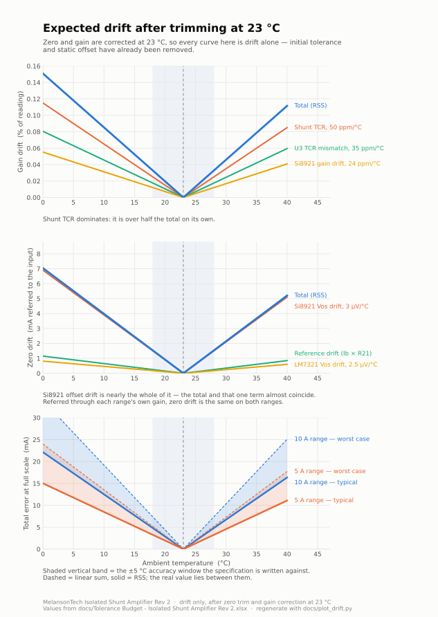

# Design Review — MelansonTech Isolated Shunt Amplifier (Rev 2)

Reviewed 2026-08-20 against `Isolated Current Sense.PDF` (schematic set, 2026-03-08),
`BOM_PartType-...Rev 2.xls`, and `Simulation/Amplifer.asc`. Schematic-level only — the PCB
layout (`.CSPcbDoc`) and Gerbers were not examined, so nothing here covers creepage, clearance,
Kelvin routing or thermal spreading on copper.

Findings are ordered by how much they threaten the published specs.

> **Revised 2026-08-20 after designer feedback.** Two items in the first draft of this review
> were wrong because they assumed the wrong power architecture. The 15 V auxiliary input is an
> **isolated** supply and `ISenseRTN` is **bonded to chassis**, which makes the 6 V node the
> system reference rather than a floating mid-rail. Findings 1 and 3 have been rewritten
> accordingly; the original §1 ("the SMA shell sits at 6 V") described the architecture working
> as intended, not a defect.
>
> **Revised again after further feedback.** `R28` is fitted as **100 Ω**, per the schematic — so
> §4 is a BOM error, not a schematic error, the reverse of what was first written. §7 now carries
> a real tolerance stack-up built from the Si8921 and WSL3637 datasheets instead of the earlier
> hand-waved figure, and §3 drops the "use 10 k dividers" suggestion, which would have broken the
> trim.
>
> **Third revision.** The ranges are **10 A at ×10** (1.0 V full scale) and **5 A at ×100**
> (5.0 V full scale) — the switch legends are scale factors, not limits, and the ×100 range stops
> where the 5 V output ceiling does. There is also **no gain trim on the board**, so the "after
> gain calibration" figures earlier drafts leaned on are not something the instrument can do,
> only something a user can do downstream. §7 is rebuilt around both facts. §7 also now
> shows the static offsets at full value and credits `R28` with removing them — untrimmed, they
> are 4.4 % and 17.3 % of full scale. Working model:
> [`Tolerance Budget - Isolated Shunt Amplifier Rev 2.xlsx`](Tolerance%20Budget%20-%20Isolated%20Shunt%20Amplifier%20Rev%202.xlsx).

---

## 1. The isolated-auxiliary-supply requirement is undocumented — **high (documentation)**

The architecture is: `ISenseRTN` — the ~6 V node driven by `U5` — is **bonded to chassis**, so it
is the reference everything else is measured against. Board `GND` therefore floats **6 V below
chassis**, and the 15 V auxiliary input connects to that floating `GND`. That makes the SMA
shell a proper chassis-referenced return, and the output a normal ground-referenced
signal from the user's point of view. It works, and it avoids needing a negative rail.

It only works, however, if **the 15 V auxiliary supply is genuinely isolated** — floating, with
neither output pole bonded to earth. Nothing in the published documentation says so, and the
failure it causes is not obvious from the outside:

- Board `GND` = the aux supply's negative = 6 V below chassis.
- Chassis = `ISenseRTN` = earthed via the instrument connected to the SMA.
- If the aux supply's negative is also earthed, `U5`'s output is shorted to earth through that
  path. U5 goes into current limit (~±100 mA), dissipating ~0.6 W in a SOT-23-5, and the
  measurement collapses.

Plenty of plausible supplies do bond the negative to earth: many bench PSUs when the negative
terminal is strapped to the earth post, anything USB-derived (host ground is usually earthed),
some three-terminal desktop bricks, and most PoE/rack-mount aux rails. A two-pin
double-insulated wall adapter is fine, and so is a bench supply with genuinely floating outputs.

Recommended:

- State the requirement prominently — datasheet, README, silkscreen, and the enclosure label.
  Something like *"Auxiliary input: 15 V, isolated/floating supply only. Do not use a supply
  whose negative output is bonded to earth."*
- Add the corollary: **one isolated supply per board.** Two boards sharing a single supply have
  their `GND` nodes tied while both chassis are earthed, so the two `U5` outputs are paralleled
  through earth and will fight each other by the difference in their 6 V references.
- Consider a series resistor (100 Ω–1 kΩ) in the chassis-bond leg so that a wrong supply
  degrades accuracy and gets noticed, rather than putting U5 into thermal limit. Cheap insurance
  against a mistake the user cannot see.

Related and independent of all the above: the source impedance is `R4 ∥ R8` = 50 Ω, so a 50 Ω
*terminated* instrument reads **half** the true output. Fine into 1 MΩ; a footgun into 50 Ω.
Worth stating in the docs either way.

## 2. Below ~14.9 V the +12 rail stops regulating — **medium**, revised

The published auxiliary input is **13–15 V**. `U1` is a UA78L12ACPKG3, whose regulation is
specified from **14.5 V in**, and `VregIn` is not the jack voltage — an `MBR0560` Schottky
(~0.35 V) and the magnetics (~0.02 V) sit in between. So the regulator needs about **14.9 V at
the jack**, and everything below that is out of regulation:

| Vin | `VregIn` | +12 rail | 6 V reference | Swing above the reference | 5 A range needs 5 V |
|---|---|---|---|---|---|
| 13.0 V | 12.63 V | **10.93 V** | 5.47 V | 5.32 V | OK, 0.32 V margin |
| 14.0 V | 13.63 V | **11.93 V** | 5.97 V | 5.82 V | OK |
| **14.9 V** | 14.53 V | **12.00 V** | 6.00 V | 5.85 V | OK — regulation starts here |
| 15.0 V | 14.63 V | 12.00 V | 6.00 V | 5.85 V | OK |

**The board still works at 13 V, and the reason is worth understanding.** The rail sags to about
10.9 V and the "6 V" reference with it, to 5.47 V — but `DiffAmpRef` and `ISenseRTN` are generated
by *identical* dividers from that same rail, so both move together and their difference stays
nulled. Gain is set by resistor ratios and the Si8921, which runs from the regulated +5 V, so it
does not move either. **Zero and gain both survive an unregulated rail.** That is the third time
the matched-divider architecture has paid for itself in this review.

What actually degrades is **output headroom**. At 13 V there is 5.32 V of swing above the
reference against the 5.0 V the 5 A range needs at full scale — a 6 % margin. Any further sag,
ripple, or a supply reading low clips the top of that range.

An earlier draft of this review called this a hard failure at 15 V. That was wrong in both
directions: 15 V is comfortably inside regulation, and 13 V degrades gracefully rather than
breaking.

### The real constraint is at the other end

Two limits close in from opposite sides:

| Limit | Value | Set by |
|---|---|---|
| Minimum for a regulated +12 rail | **14.87 V** | `U1` needs 14.5 V, plus the 0.37 V input path |
| Maximum continuous | **15.6 V** | `Rel1` coil — G6L-1F DC12 at 130 % of its 12 V rating |

So **full specified performance is only available between about 14.9 V and 15.6 V** — a ±2.4 %
window around 15.2 V. The published 13–15 V range delivers a working instrument across its whole
span, but a *regulated* one only in the top 100 mV of it.

And the two ends trade against each other:

| | 13 V | 15 V |
|---|---|---|
| +12 rail | unregulated, ~10.9 V | regulated |
| Output headroom on the 5 A range | 0.32 V | 0.85 V |
| `U6` dissipation | 0.46 W | 0.58 W |
| `Rel1` coil | 108 % of rating, 154 mW | 125 % of rating, 205 mW |

**13 V is easier on the thermals and the relay; 15 V is the only end that regulates.** The design
is squeezed from both directions, which is what makes the window narrow.

### What to do

- **Document it honestly:** 13–15 V for operation, 15 V nominal, and note that the +12 rail is
  unregulated below ~14.9 V with reduced headroom on the 5 A range.
- **On a future revision, replace `U1`** with a low-dropout 12 V part. A 300 mV LDO moves the
  regulation threshold from 14.87 V down to about 12.7 V, which makes the whole 13–15 V range
  regulated and removes this finding entirely. There are many in SOT-89.
- **Drive the relay coil from +12 rather than `Vin`.** That removes the 15.6 V ceiling, and the
  coil then sees a regulated 12 V instead of 108–130 % of its rating.

Those two changes together turn a ±2.4 % window into a genuine 13–16 V input range.

## 3. Offset trim works, but its residual drift is untrimmable — **medium**

Two separate 6 V nodes are generated, and this is deliberate:

- `ISenseRTN` = `R22`/`R17` (100 k, 0.1 %) → `C4` → buffered by `U5`. Fixed. Bonded to chassis.
  This is the system reference.
- `DiffAmpRef` = `R26`/`R29` (100 k, 0.1 %) + **`R28` trimmer** → `R21`/`C26` → buffered by `U9`.
  Adjustable, by design.

`U8` is referenced to `ISenseRTN` while its input is referenced to `DiffAmpRef`, so moving
`DiffAmpRef` moves the output zero. That is exactly what `R28` is for: it nulls the **whole
chain's** input-referred offset in one adjustment — the divider tolerances, both LM7321 input
offsets, U3's offset, and the bias-current terms below. Because the trim happens ahead of `U8`,
a null on one range holds on the other. This is a sound approach and the earlier draft of this
review was wrong to treat the two dividers as an error rather than a feature.

The fitted 100 Ω trimmer gives **±3.0 mV** of range at `DiffAmpRef` with a **60 µV** settable
step — 0.06 % of full scale at the output on the ×100 range (finding 4). That it has enough
range is itself a measurement: **the total untrimmed offset at `DiffAmpRef` is under 3 mV.**

That bound is useful, because it retires a concern this review raised in its first draft. The
LM7321 has bipolar inputs, and `U9`'s non-inverting input looks back into 100 k ∥ 100 k plus
`R21` 10 k ≈ **60 kΩ** while `U5`'s looks into ≈ **50 kΩ**, so a bias current of 1 µA would
produce ~10 mV of *difference* between the two nodes. The 100 Ω pot could not absorb that. Since
it does absorb what is there, **Ib must be well under ~300 nA in practice**, and the term is
small rather than dominant.

### The matching is deliberate, and it is doing most of the work

Three symmetries here are design choices, not accidents, and each kills a term that would
otherwise land in the budget:

- **Both buffers are LM7321.** Same part, so bias current is matched in magnitude, in sign, and
  in how it moves with temperature. The common-mode part of Ib drift therefore cancels between
  the two references.
- **Both dividers are the same topology from the same rail.** So `U1`'s tempco and line
  regulation move both 6 V nodes together and cancel out.
- **Both low-pass filters land at the same corner.** This review previously claimed `C4` filtered
  "much less" than `R21`/`C26`. That was wrong — the divider's own 50 kΩ is the series resistance
  on the `U5` side, so the poles are **31.8 Hz (U5)** and **26.5 Hz (U9)**. Essentially matched,
  and no change is warranted.

### The one asymmetry that remains

Matched bias current only cancels if it flows through matched impedance, and here it does not:

| | source impedance at the (+) input |
|---|---|
| `U9` → `DiffAmpRef` | `R26`∥`R29` = 50 kΩ **+ `R21` 10 kΩ = 60 kΩ** |
| `U5` → `ISenseRTN` | `R22`∥`R17` = **50 kΩ** |

`R21` is there for the noise filter, but it also makes the two legs differ by 10 kΩ. The
reference difference is therefore `Ib × 10 kΩ` plus a mismatch term, and it is the **common-mode**
Ib — the large, well-matched part — that acts on that 10 kΩ. Matching the devices does not
address it; only matching the impedances does.

There are two ways to equalise the legs — raise `U5` to 60 kΩ, or lower `U9` to 50 kΩ. **Lowering
`U9` by changing `R21` from 10 kΩ to 100 Ω is the better of the two**, and it is a value change
on a part that is already there rather than an added component:

| | Z at `U9` (+) | Z at `U5` (+) | asymmetry | `U9` pole | `U5` pole | ref drift, ×100 range |
|---|---|---|---|---|---|---|
| As built | 60.0 kΩ | 50.0 kΩ | 10 kΩ | 26.5 Hz | 31.8 Hz | 0.210 % FS |
| Add 10 kΩ at `U5` (+) | 60.0 kΩ | 60.0 kΩ | 0 | 26.5 Hz | 26.5 Hz | 0.120 % FS |
| **`R21` → 100 Ω** | **50.1 kΩ** | **50.0 kΩ** | **100 Ω** | **31.8 Hz** | **31.8 Hz** | **0.101 % FS** |
| `R21` → 0 Ω (link) | 50.0 kΩ | 50.0 kΩ | 0 | 31.8 Hz | 31.8 Hz | 0.100 % FS |

*(Ib 50 nA, 20 % device mismatch, Ib moving 20 % across the temperature excursion. Full scale 1 V.)*

`R21` → 100 Ω wins on four counts at once:

- **Better than adding a resistor at `U5`** — 2.1× versus 1.8×. Equalising at the *lower*
  impedance leaves the surviving mismatch term working into 50 kΩ instead of 60 kΩ.
- **The filter is unaffected.** `R21` was only ever 1/6 of the pole's series resistance; the
  divider's own 50 kΩ does the work. Both corners land on 31.8 Hz — better matched than as built.
- **It takes 0.5 mV off the trim's workload.** Ib × `R21` currently shifts `DiffAmpRef` by that
  much before the pot sees it; at 100 Ω the term is 5 µV.
- **Slightly quieter** — 12.9 nV/√Hz of Johnson noise becomes 1.3 nV/√Hz. Minor next to the
  divider's 28.8 nV/√Hz, but free.

Keep 100 Ω rather than going to a link: it still damps the trimmer wiper into `C26`, so
adjustment stays smooth and there is no charge injection from a mechanical contact straight onto
a 100 nF cap. Going to 0 Ω buys 0.001 % FS and gives that up.

Be clear about the size of the prize, though: **2.1× on this one term**, not an order of
magnitude. At an assumed 50 nA it goes from ~0.21 % FS to ~0.10 % FS on the ×100 range — real,
but still well below the Si8921's own 0.60 % offset drift (finding 7). It is a one-character BOM
change to bank on the next revision, not a reason to respin.

**Do not** attack this by dropping the dividers to 10 k. With `R26`/`R29` at 10 k and `R28`
unchanged, the pot becomes a third of the string and the trim range explodes to roughly **±2 V**,
which would make the trim useless. Any change to the divider must scale `R28` in proportion.

Longer term, deriving the 6 V from a real reference (LM4040/REF3130) rather than a divider off
the regulator would stop it tracking `U1` at all — but note that the matched-topology symmetry
above already handles most of what that would buy.

## 4. `R28` is 100 Ω on the schematic and 10 kΩ in the BOM — **high (BOM error)**

The schematic annotates `R28` as **100 Ω**; the BOM specifies **CT94EW103, a 10 kΩ trimmer**.

**The schematic is right and the BOM line is wrong** — confirmed on hardware, where the fitted
100 Ω part trims offset properly. An earlier draft of this review had this backwards, because it
checked only whether the trim range was large enough and never asked how *finely* the trim could
be set. Range is the easy half of the problem:

| `R28` | trim range at `DiffAmpRef` | settable step (1-turn, ~1 % of span) | at the output, ×100 range |
|---|---|---|---|
| **100 Ω (fitted)** | **±3.0 mV** | **60 µV** | **0.060 % FS** |
| 200 Ω | ±6.0 mV | 120 µV | 0.120 % FS |
| 500 Ω | ±15.0 mV | 299 µV | 0.299 % FS |
| 1 kΩ | ±29.9 mV | 597 µV | 0.597 % FS |
| 10 kΩ (BOM) | ±285.7 mV | 5.71 mV | **5.71 % FS** |

A `DiffAmpRef` error is multiplied by `U8`'s gain of 10 on the high-gain range, and the
calibrated full scale is 1 V — so the 10 kΩ part could not place zero closer than about 5.7 % of
full scale. It would be unusable, and it would be the single largest error term on the board by
a factor of ten. Fix the BOM line, not the schematic.

That the fitted 100 Ω has enough range is also a useful measurement in its own right: it bounds
the total untrimmed offset at `DiffAmpRef` to under 3 mV, which caps the bias-current term in
finding 3 at roughly 300 nA — well under the datasheet maximum that finding originally assumed.

Full range-versus-resolution table in the **R28 sizing** tab of
[`Tolerance Budget - Isolated Shunt Amplifier Rev 2.xlsx`](Tolerance%20Budget%20-%20Isolated%20Shunt%20Amplifier%20Rev%202.xlsx).

## 5. `U6` dissipation at 15 V input — **medium**

`U6` (HT7550-1, SOT-89) drops `VregIn` ≈ 14.6 V to 5 V. Its load is `PSU1` (NXJ1S0505T6MC-R7,
unregulated 1 W module) plus the +5 domain. `R6` (220 Ω preload on `+5_ISO`, deliberate and
correct for an unregulated module) alone draws ~23 mA, and the Si8921 adds several mA, so
U6 carries on the order of 50–60 mA.

That is **~0.55–0.6 W in a SOT-89**, which at a typical 100–160 °C/W θJA is a 60–95 °C rise.
Comfortably hot, near or past the sensible limit on a small copper pour, and it sits on the same
board as a precision 6 V reference divider and a 0.05 % gain network — thermal gradients here
turn straight into measurement drift.

Suggestions: feed U6 from the +12 V rail instead of `VregIn` (drop falls from ~9.6 V to 7 V,
dissipation to ~0.4 W); or drop a series resistor ahead of it to share the heat; or use a small
buck. Whichever you pick, keep U6 physically far from `R26`/`R29`/`R22`/`R17` and the diff-amp
resistors, and give it its own copper.

## 6. `J2` is rated 400 V, the datasheet claims 500 Vdc common mode — **medium**

`J2` is a Phoenix Contact 5442002 (2-position, 5.08 mm), rated **12 A / 400 V**. The product
description claims a **500 Vdc** input common-mode range.

The isolation devices are fine — the Si8921 in wide-body SOIC and the NXJ1S0505 are both 4.2 kV
rated — but the input connector is the weakest link in the barrier and it is under-rated for the
published number. Either specify a 600 V-rated terminal block, or drop the published figure to
400 Vdc (which is honest and still excellent).

Two related items to confirm from the layout, which this review could not check:

- Creepage/clearance under `U2` and `PSU1`, and along the `GND_ISO` pour boundary, for 500 Vdc
  **continuous working** voltage — not the 4.2 kV one-minute surge number.
- Whether the Si8921's `VIORM` (continuous working voltage) actually covers 500 Vdc. The 4.2 kV
  figure is a withstand rating and is not the same thing.

## 7. Accuracy: the full tolerance stack-up — **medium**

An earlier draft of this review asserted "~0.75 % from the shunt, degrading toward 1.5 %" without
showing the arithmetic, never added the rest of the chain, and assumed a 10 A range. Here is
the actual budget. The live model, with every assumption as an editable cell, is
[`Tolerance Budget - Isolated Shunt Amplifier Rev 2.xlsx`](Tolerance%20Budget%20-%20Isolated%20Shunt%20Amplifier%20Rev%202.xlsx).

**Three things have to be pinned down before any of it means anything.**

*The switch legends are scale factors, not range limits.* "1 V/10 A" and "1 V/1 A" say how many
volts you get per amp; each range then runs to its own maximum:

| Switch position | Gain | Scale factor | Max current | Shunt voltage | Full-scale output |
|---|---|---|---|---|---|
| 2 | ×10 | 1 V / 10 A | **10 A** | 100 mV | **1.0 V** |
| 3 | ×100 | 1 V / 1 A | **5 A** | 50 mV | **5.0 V** |

The ×100 range stops at 5 A because that is where the output hits its 5 V ceiling
(5 V ÷ 100 ÷ 10 mΩ = 5 A). The ×10 range stops at 10 A on the shunt and connector. So the
higher-gain range is a *finer* range over a smaller span, not a lower-current one — and both
percentages below are of each range's own full scale.

*The ±4.5 V on the `J1` silkscreen conflicts with this.* A 5 A reading on the ×100 range is 5.0 V
out, which exceeds it. An LM7321 running rail-to-rail on +12 V about a 6 V reference can swing
roughly ±5.8 V, so 5 V is achievable — but the silkscreen, the documentation and the actual
range limit should be reconciled, and the number that matters is 5 V.

*Shunt self-heating is calculable.* The WSL3637 datasheet gives 3.0 W at 70 °C ambient with a
derating curve reaching zero at 170 °C, implying **33.3 °C/W**. On the ×10 range at 10 A the part
dissipates 1 W, so the rise is **33 °C** and the drift term **0.167 %**. On the ×100 range at 5 A
it is 0.25 W, an 8.3 °C rise and **0.042 %** — power goes as I², so halving the current quarters
the term.

### Every static offset is nulled by R28 — and that is doing real work

Before the pot is touched, the static offsets alone are:

| Static term, referred to full scale | 10 A range (1.0 V FS) | 5 A range (5.0 V FS) |
|---|---|---|
| Si8921B input offset, ±0.15 mV max | 0.150 % | 0.300 % |
| Two LM7321 Vos at ±5 mV max (RSS) | 0.707 % | 1.414 % |
| Reference divider tolerance, 4 × 0.1 % | 0.600 % | 1.200 % |
| Ib × the 10 kΩ `R21` asymmetry | 0.050 % | 0.100 % |

Untrimmed that is **2.88 %** and **4.54 %** worst case. `R28` removes all of it in one adjustment.

### Gain terms — % of reading

**There is no gain trim on the board.** `R28` sets zero; nothing sets gain. Every term below is
present in the shipped instrument and can only be removed by the user applying a scale factor in
their own DAQ or software.

| Term | ± % | Removable? |
|---|---|---|
| `R5` initial tolerance (±0.5 %) | 0.500 | user scale factor only |
| **`R5` self-heating** *(0.167 % at 10 A, 0.042 % at 5 A)* | 0.167 / 0.042 | **no** |
| `R5` ambient drift, ±20 °C | 0.100 | no |
| Si8921B gain error, max | 0.200 | user scale factor only |
| Si8921B gain drift | 0.048 | no |
| `U3` ratio, ±0.05 % and ±0.1 % (RSS) | 0.112 | user scale factor only |
| `U3` TCR mismatch | 0.070 | no |
| `U8` network ratio *(×100 only)* | 0.073 | user scale factor only |
| `U8` TCR mismatch *(×100 only)* | 0.045 | no |
| `Rel1` contact resistance *(×100 only)* | 0.057 | user scale factor only |

### Drift and full-scale terms — % of each range's full scale

| Term | 10 A range (×10) | 5 A range (×100) |
|---|---|---|
| Si8921B input offset drift, 3 µV/°C × 20 °C | 0.060 | 0.120 |
| Si8921B nonlinearity, max | 0.080 | 0.080 |
| Reference drift, `DiffAmpRef` vs `ISenseRTN` *(est.)* | 0.021 | 0.042 |
| Two LM7321 Vos drift, ±2.5 µV/°C | 0.007 | 0.014 |
| `R28` trim resolution, 100 Ω single-turn | 0.006 | 0.012 |
| Shunt thermal EMF, ~5 µV *(estimate)* | 0.005 | 0.010 |

The ×100 range doubles every offset term rather than multiplying it by ten, because its full
scale is 5 V rather than 1 V. That is a genuinely good property of the range plan and it is why
the two ranges end up within a few hundredths of a percent of each other.

### Totals at a full-scale reading

| | 10 A range (×10) | 5 A range (×100) |
|---|---|---|
| As built, untrimmed, worst case | 2.88 % | 4.54 % |
| As built, untrimmed, RSS | 1.12 % | 1.97 % |
| **AS SHIPPED — `R28` trimmed, worst case** | **1.38 %** | **1.53 %** |
| **AS SHIPPED — `R28` trimmed, RSS** | **0.60 %** | **0.60 %** |
| + user scale factor, worst case *(not a board feature)* | 0.56 % | 0.58 % |
| + user scale factor, RSS *(not a board feature)* | 0.24 % | 0.21 % |

### So where does it exceed 1 %?

1. **As shipped, worst case — 1.38 % and 1.53 %. Both ranges, by a similar margin.** Three terms
   account for nearly all of it: `R5`'s ±0.5 % initial tolerance, the Si8921's ±0.2 % gain error,
   and on the ×10 range the 0.167 % of shunt self-heating. The first two are systematic per unit
   and would vanish under a gain calibration the board cannot perform.
2. **As shipped, typical — 0.60 % on both. Comfortably inside 1 %.**
3. **Nowhere is it offset-limited.** An earlier draft of this review concluded the high-gain range
   was dominated by Si8921 offset drift; that was an artefact of assuming a 1 V full scale for it.
   At the real 5 V full scale the term is 0.120 %, and the budget is gain-limited on both ranges.

The two ranges being within 0.03 % of each other on RSS is not a coincidence — the ×100 range
trades four times the shunt self-heating away for twice the offset weight, and the two roughly
cancel. The range plan is well balanced.

### The specification, in instrument form

A single percentage is the wrong shape for this. Gain terms scale with the reading; offset terms
are fixed in amps and do not shrink as the reading does. The standard ±(% of reading + fixed)
form separates them:

| | 10 A range (×10) | 5 A range (×100) |
|---|---|---|
| **Published (hybrid basis, see below)** | **±(1.0 % of reading + 12 mA)** | **±(0.9 % of reading + 8 mA)** |
| Linear worst case *(a bound, not a prediction)* | ±(1.03 % of reading + 11.3 mA) | ±(1.05 % of reading + 7.3 mA) |
| Typical (pure RSS) | ±(0.58 % of reading + 8.2 mA) | ±(0.56 % of reading + 4.4 mA) |
| + user gain calibration, worst case | ±(0.22 % of reading + 11.3 mA) | ±(0.11 % of reading + 7.3 mA) |
| + user gain calibration, typical | ±(0.17 % of reading + 8.2 mA) | ±(0.05 % of reading + 4.4 mA) |

*All at 23 °C ± 5 °C.*

#### Drift versus temperature



Regenerate with [`docs/plot_drift.py`](plot_drift.py). Numbers behind it:

| Ambient | Gain drift, % of reading | Zero drift, mA at the input | Total at FS, 10 A range | Total at FS, 5 A range |
|---|---|---|---|---|
| 0 °C | 0.151 % | 7.04 mA | 22.1 mA | 15.0 mA |
| 10 °C | 0.085 % | 3.98 mA | 12.5 mA | 8.5 mA |
| 18 °C | 0.033 % | 1.53 mA | 4.8 mA | 3.3 mA |
| **23 °C (trim point)** | **0** | **0** | **0** | **0** |
| 28 °C | 0.033 % | 1.53 mA | 4.8 mA | 3.3 mA |
| 35 °C | 0.079 % | 3.67 mA | 11.5 mA | 7.8 mA |
| 40 °C | 0.111 % | 5.21 mA | 16.4 mA | 11.1 mA |

Three things the plot makes obvious that the tables do not:

- **Shunt TCR is over half the gain drift on its own.** The ±0.1 % / ±15 ppm shunt recommended
  below therefore does double duty — it cuts both the initial tolerance and the largest drift term.
- **Zero drift is almost entirely Si8921 offset drift.** The reference and LM7321 terms together
  are under a fifth of it, which is why the `R21` change in finding 3 is worth doing but is not
  where the leverage is.
- **Zero drift referred to the input is identical on both ranges.** Each range's offset terms
  scale exactly with its own gain, so they cancel on referral — a real virtue of the range plan.

#### The fixed term is not un-nulled offset

Worth being explicit, because "there is a fixed term" and "the offset is zeroed" sound like they
contradict each other. They do not. **Static offset is already zero in this budget** — every
static term is classified `R28 trim` and excluded from the shipped totals. What survives is what
zeroing cannot reach:

| Fixed-term component | 10 A range | 5 A range | Why zeroing misses it |
|---|---|---|---|
| Si8921B input offset, ±0.15 mV static | **0.000 %** | **0.000 %** | nulled by `R28` |
| Two LM7321 Vos, ±5 mV static | **0.000 %** | **0.000 %** | nulled by `R28` |
| Reference divider tolerance, static | **0.000 %** | **0.000 %** | nulled by `R28` |
| Si8921B input offset **drift**, 3 µV/°C | 0.060 % | 0.120 % | appears *after* the trim, as temperature moves |
| Si8921B **nonlinearity** | 0.080 % | 0.080 % | not an offset — a bow in the transfer curve |
| Reference **drift** *(est.)* | 0.021 % | 0.042 % | appears after the trim |
| LM7321 Vos **drift**, ±2.5 µV/°C | 0.007 % | 0.014 % | appears after the trim |
| `R28` setting resolution | 0.006 % | 0.012 % | you cannot set the pot infinitely finely |
| Shunt thermal EMF | 0.005 % | 0.010 % | varies with the terminal gradient |

Zeroing removes the offset present *at the moment and temperature you zero it*. Three things
remain by construction: drift that accumulates afterwards, nonlinearity (which is not offset at
all), and the finite resolution of the adjustment itself.

That makes the fixed term a strong function of how far the board wanders from its trim
temperature — which is an editable cell in the budget:

| Excursion from the trim temperature | Fixed term, 10 A range | Fixed term, 5 A range |
|---|---|---|
| ±20 °C (full 0–40 °C operating range) | 17.9 mA | 13.9 mA |
| ±10 °C | 13.5 mA | 9.5 mA |
| **±5 °C (the published accuracy window)** | **11.3 mA** | **7.3 mA** |
| 0 °C (re-zeroed immediately before use) | **9.1 mA** | **5.1 mA** |

So a user who re-trims at the working temperature roughly halves the fixed term, and the floor
they hit — 9.1 mA and 5.1 mA — is almost entirely Si8921 nonlinearity. That is a genuinely useful
thing to put in the documentation: **the zero trim is worth repeating if the board has moved
temperature, and there is no point chasing below the nonlinearity floor.**

The published specification uses the ±5 °C window; over the full 0–40 °C operating range the
temperature coefficient given above covers the rest.

#### Why the fixed term matters more than the percentage

It sets a hard limit on small readings, and it is the reason a percentage-only spec flatters the
instrument:

| Reading | 10 A range, as-shipped typical | 5 A range, as-shipped typical |
|---|---|---|
| Full scale | ±66 mA (0.66 % of reading) | ±32 mA (0.65 % of reading) |
| 50 % of range | ±37 mA (0.74 %) | ±18 mA (0.74 %) |
| 10 % of range | ±14 mA (1.40 %) | ±7 mA (1.44 %) |

**Below roughly a third of range, the fixed term dominates and the error as a percentage of
reading climbs past 1 % on both ranges.** That is normal for an instrument of this class and is
exactly why the two-term form should be published rather than a single number.

Note the ranges overlap usefully: 5 A reads on either, at ±36 mA on the ×100 range against
±40 mA on the ×10 range — so switching down is worth it below 5 A, and increasingly so as the
current falls.

### Recommended published specification

**Accuracy** — after the zero trim (`R28`), output into ≥ 1 MΩ, isolated auxiliary supply,
30 minutes after power-on.

| Range | 23 °C ± 5 °C | Typical |
|---|---|---|
| **10 A (×10)** | **±(1.0 % of reading + 12 mA)** | ±(0.6 % of reading + 9 mA) |
| **5 A (×100)** | **±(0.9 % of reading + 8 mA)** | ±(0.6 % of reading + 5 mA) |

Referred to the output, the fixed terms are **1.2 mV** and **8 mV** respectively.

**Temperature coefficient**, outside 23 °C ± 5 °C: ±(0.011 % of reading + 0.5 mA) / °C.

**Operating range** 0 °C to 40 °C. *(Confirm against finding 5 — `U6` runs warm.)*

**With a user gain calibration** — one known current, scale factor applied in the user's system:

| Range | 23 °C ± 5 °C |
|---|---|
| 10 A (×10) | ±(0.25 % of reading + 12 mA) |
| 5 A (×100) | ±(0.15 % of reading + 8 mA) |

#### Is a linear worst-case sum realistic? No — and the spec above does not use one

*Reproduce everything in this section with [`docs/tolerance_monte_carlo.py`](tolerance_monte_carlo.py) —
`python3 tolerance_monte_carlo.py`, or `--dt 20` for the full operating range.*

A linear sum assumes every tolerance lands at its limit *and* all in the same direction. It is a
bound, not a prediction. A Monte Carlo over 2 million boards, with every tolerance **uniform**
within its limit — the most conservative distribution assumption, no central tendency at all —
gives this for the 10 A range at 23 °C ± 5 °C:

| | Total error | as a fraction of the 1.185 % linear sum |
|---|---|---|
| Median | 0.255 % | 22 % |
| 90th percentile | 0.543 % | 46 % |
| 99th percentile | 0.750 % | 63 % |
| 99.9th percentile | 0.869 % | 73 % |
| Worst of 2 000 000 boards | 1.056 % | 89 % |

The linear sum was **never reached in two million trials**, and P(error > 1.0 %) came out around
**1 in 125 000**. Assume normal distributions with the limit at 3σ — the usual model for tested
parts — and the worst of two million was 0.87 %, with 1.0 % never exceeded at all.

So publishing 1.185 % would be quoting a number no real board produces.

**But pure RSS (0.582 %) is too optimistic**, because independence fails in exactly one place: a
reel. A hundred boards built from one reel of shunts and one tube of isolators all share the same
offset from nominal. Those terms do not average out board to board — they act as a common bias.
Simulating that directly: with the batch sitting at 100 % of the dominant limit, the median error
is 0.700 % and P(> 1 %) climbs to 0.45 %, from essentially zero.

**The hybrid is the standard resolution, and it is what the numbers above use:** hold the two
dominant, batch-correlated initial-tolerance terms at their limits — `R5` at ±0.5 % and the
Si8921 gain error at ±0.2 % — and RSS everything else.

| | 10 A range | 5 A range |
|---|---|---|
| Batch-correlated terms, at their limits | 0.700 % | 0.700 % |
| Everything else, RSS | 0.220 % | 0.178 % |
| **Hybrid** | **0.920 %** | **0.878 %** |
| *(linear worst case, for comparison)* | *1.185 %* | *1.235 %* |
| *(pure RSS, for comparison)* | *0.582 %* | *0.567 %* |

Rounded up, that is the **±1.0 %** and **±0.9 %** published above. It survives a bad reel, it does
not quote an unreachable bound, and — worth noting — **it lets the "better than 1 %" claim stand
honestly**, which the linear sum did not.

#### Why these choices

**Publish a guaranteed number, not the typical.** For a manufacturer you could test and bin, so a
typical figure is defensible. This is an open-source design where someone builds from your BOM
with whatever parts they can source, so the headline has to hold for a bad batch. That does not
mean the linear worst case — see the section above — but it does mean more than RSS.

**23 °C ± 5 °C is the right window, and tightening it further is not worth it.** The industry norm
is ±5 °C, and the numbers say the same thing:

| Accuracy window | 10 A range | 5 A range |
|---|---|---|
| ±0 °C (impossible) | 0.98 % | 0.99 % |
| ±3 °C | 1.01 % | 1.02 % |
| **±5 °C** | **1.03 %** | **1.05 %** |
| ±10 °C | 1.09 % | 1.12 % |

Going from ±5 °C to ±3 °C buys 0.02 % and makes the spec harder to hold. **And no temperature
window gets the proportional term below ~0.98 %**, because 0.98 of the 1.03 is
temperature-independent: `R5`'s ±0.5 % initial tolerance, the Si8921's ±0.2 % gain error, `R5`
self-heating at full current, and the `U3` resistor ratio. Tightening the window is not a route
to a sub-1 % instrument.

**The ±(% of reading + fixed) form is not optional here.** The fixed term is 1.2 % of reading at
10 % of range on the 10 A range and 1.6 % on the 5 A range — a single-percentage spec would be
wrong by more than a factor of two at the bottom of each range.

#### The one change that gets it under 1 %

Replace `R5` with a ±0.1 % / ±15 ppm sense resistor (Vishay WSBM or CSS, Bourns CSS):

| Range | 23 °C ± 5 °C, as shipped |
|---|---|
| 10 A (×10) | **±(0.5 % of reading + 11 mA)** linear worst case, **±(0.4 % + 11 mA)** hybrid |
| 5 A (×100) | **±(0.6 % of reading + 7 mA)** linear worst case, **±(0.4 % + 7 mA)** hybrid |

One BOM line. No board change, no calibration step, no new failure mode — and it halves the
temperature coefficient at the same time, because the shunt's TCR is the largest contributor to
it. The ±1 % claim is already defensible on the hybrid basis; this would make it comfortable
rather than marginal, and would put a ±0.5 % claim within reach.

### Should the board have a gain trim?

Probably not, and it is worth saying why rather than leaving it as an implied criticism. A gain
trimmer in the `U3` or `U8` network would put a 100 ppm/°C cermet element in series with ±25 ppm
precision resistors, trading initial accuracy for drift — usually a bad bargain. Two better
routes:

- **Publish a per-unit calibration constant.** Measure each board once against a known current
  and print the scale factor on the label. One measurement per unit, gets the user the 0.21 %
  column, adds no drift.
- **Tighten the shunt.** A ±0.1 % / ±15 ppm part (Vishay WSBM/CSS, Bourns CSS) removes 0.4 % of
  the 0.5 % term outright and cuts the self-heating drift by more than three times — the single
  biggest improvement available without a calibration step.

### If you want it better

- **The shunt's ±0.5 % is the largest single gain term, and it is free to remove** — one gain constant
  in whatever reads the output. If the instrument is used with a fixed DAQ, calibrate and publish
  the calibrated number.
- **To improve the 1 A range you must attack Si8921 offset drift**, since it is nearly half the
  calibrated worst case. The only real levers are a larger shunt voltage at 1 A (a second, larger
  shunt switched in with the range — this is what your "alt shunt" sheet appears to be exploring)
  or a lower-drift isolator. Tightening resistors will not help.
- A ±0.1 % / ±15 ppm sense resistor (Vishay WSBM/CSS, Bourns CSS) removes 0.5 % of uncalibrated
  error and two-thirds of the shunt drift, if you would rather not calibrate at all.
- `R5` *is* a 4-terminal Kelvin device, which is the right choice. Confirm the footprint actually
  routes the sense pads separately from the current pads — this review did not examine the layout.

## 8. Bandwidth was tuned empirically — and the data exists — **resolved**

This finding originally said the ×100 figure "doesn't obviously fall out of the schematic." That
was correct as far as it went, and the reason is now clear: **it was set on the bench, not
derived.**

`Revision 1/TestData/BodePlots/` in the release repository contains 31 measured sweeps —
something this review previously stated did not exist. The filenames alone tell the story:

```
1khz-1Meghz Gain 100x 0r010Shunt_2.2nf output filt.xlsx
1khz-1Meghz Gain 100x 0r010Shunt_2nf   output filt.xlsx
100hz-1Mkhz Gain 100x 0r010Shunt_3.3nf output filt.xlsx
100hz-1Mkhz Gain 100x 0r010Shunt_4nf   output filt.xlsx
100hz-200khz Gain 100x 0r010Shunt_4.7nf output filt.xlsx
100hz-200khz Gain 100x 0r010Shunt_6.8nf output filt.xlsx
1khz-1Meghz Gain 100x 0r010Shunt_10nf  output filt.xlsx
1khz-800khz Gain 100x 0r010Shunt_4.7nf output filt (C18+C16 10pF).xlsx
1khz-800khz Gain 100x 0r010Shunt_4.7nf output filt (C18+C16 20pF).xlsx
```

That is a systematic sweep of the output filter capacitor — 2 nF, 2.2, 3.3, 4, 4.7, 6.8, 10 nF —
plus a pass over the op-amp compensation capacitors `C18` and `C16` at 10 pF and 20 pF. The
corner was chosen by measurement and the schematic value is the *result*, which is exactly why
working backwards from the schematic did not reproduce it.

Reading two of the files directly (100 Hz–1 MHz, ×10 and ×100 with a 2.2 nF filter), each sweep
carries two response channels with −3 dB corners around **600–700 kHz** and **15–18 kHz**
respectively. The files have no header row, so which channel is which node cannot be determined
from the data alone — but both figures sit close to the documented 500 kHz and 30 kHz claims,
and the wider one is consistent with the Si8921's own 600 kHz bandwidth.

**What is still worth doing**, and it is documentation rather than design work:

- Add a header row or a legend to the Bode files so the channels are interpretable by someone
  who was not at the bench.
- State in the datasheet which capacitor sets the ×100 corner, and that it was chosen empirically.
- Re-measure on the Rev 2 or Rev 3 board — the existing data is all Rev 1, and `C8`/`C9` differ.

The design itself needs no change here. This is a case of the work having been done properly and
never written down.

## 9. `C16`, `C17`, `C28` at 3 pF are below the parasitics — **low**

3 pF C0G parts are specified across the difference amplifier (`C16`, `C17`) and at U8's input
(`C28`). PCB stray capacitance in that area is typically 0.5–2 pF and is not controlled
board-to-board, so these components set nothing repeatable and the AC CMRR of the difference amp
will vary between units.

Either raise them to 10–33 pF where the part dominates the parasitic, or delete them and let the
op-amp's own roll-off do the work. As specified they are BOM lines that buy nothing.

## 10. Difference-amp CMRR relies on four discrete resistors — **low**

`R2`/`R9` (8.2 k, ±0.05 %, ±10 ppm) and `R3`/`R20` (10 k, ±0.1 %, ±25 ppm) form the classic
four-resistor difference amp around `U3`. Two problems, both second-order here:

- The two halves have different tolerance *and* different tempco (10 vs 25 ppm/°C), so both gain
  and CMRR drift with temperature.
- Discrete 0.1 % parts give roughly 66 dB of CMRR at best.

This matters less than it normally would, because the common-mode seen by U3 is just the
Si8921's fixed ~2.5 V output common mode rather than a hostile bus voltage. Still, a matched
network (LT5400-series, or an integrated difference amp) would collapse four BOM lines into one
and remove the drift term for a couple of dollars.

## 11. Input protection and supply robustness — **low/medium**

- **No reverse-polarity protection on `J4`.** A centre-negative adapter reverse-biases `C7`, a
  1000 µF polymer electrolytic. A series Schottky or a P-FET ideal-diode is cheap insurance;
  a shunt diode plus fuse is cheaper still.
- **No fuse and no TVS** on the 15 V input.
- **`D6` (BAS31 series pair) clamps at ~1.4 V**, but the Si8921's absolute maximum on `AIP`/`AIN`
  is only ~0.5 V beyond its rails. In an overload the chip's own ESD structure conducts first,
  through `R1`/`R12` (10 Ω) — survivable but it means D6 is not actually the protection element
  it appears to be. A single diode per rail to `GND_ISO`/`+5_ISO` would clamp before the die does.
- **`C41` 1 nF with `R1`+`R12` = 20 Ω** puts the input anti-alias corner at ~8 MHz, which is no
  filtering at all ahead of a sigma-delta modulator. If you can spare the CMRR, larger series
  resistors (or a larger C41) would help; the existing schematic note about CMRR is the reason
  they are small, so this is a real trade rather than an oversight.

## 12. `SW1` is close to its ratings — **low/medium (verify)**

`SW1` (C&K OS103011MS8QP1) is rated **100 mA / 12 V**. It appears to carry the whole board
supply — `D1`/`D3` OR its two active positions into `VregIn`, so the switch is in the power path
as well as being the range-select logic. Total board current is roughly 90–100 mA at 15 V.

If that reading of the netlist is right, the switch is at ~100 % of rated current and 125 % of
rated voltage. Please confirm against the actual netlist — the schematic render is ambiguous
around the `D1`/`D3`/`Vin`/`VregIn` junction, and it is the one node I could not resolve with
confidence. If confirmed: use the switch for logic only and let a small P-FET or the always-on
rail carry the current.

Two smaller notes in the same area:

- **The relay coil runs from `HighGain` = `Vin`, i.e. ~15 V, not +12 V.** A G6L-1F DC12 tolerates
  around 130 % of rated coil voltage at room temperature (≈15.6 V), so 15 V is inside spec but
  with very little left — and coil dissipation is ~43 % above nominal, which shortens life and
  heats the board. Driving the coil from +12 V through a MOSFET would be strictly better.
- `HighGain` at 15 V also drives the `2N7002` gates directly. Vgs(max) is ±20 V, so there is
  5 V of margin and no gate resistor or clamp anywhere.

## 13. BOM has unbuildable lines — **low (documentation)**

Three parts are generic placeholders with **no value or part number**:

| Ref | Schematic says | BOM says |
|---|---|---|
| `C8` | 680 pF | `Cap`, "CAP,0805,Generic" |
| `C43` | 680 pF | `Cap`, "CAP,0805,Generic" |
| `R23` | 1 Ω | `Res1`, "Res,0805,Generic" |

`C8` and `C43` set the high-gain bandwidth (finding 8) and `R23` damps the input LC, so none of
them are optional. Several other lines show "Loading..." or "Supplier disabled" in the pricing
columns — harmless, but worth a clean regeneration before publishing the BOM.

## 14. Relay contact resistance sits in the gain network — **low**

`Rel1` switches `R14`/`R16`/`R18` (three 470 Ω in parallel = 156.7 Ω) to `ISenseRTN` to set the
×10 stage. Contact resistance (~100 mΩ initial for a G6L, rising over life) is therefore in
series with 156.7 Ω → **~0.06 % gain error initially**, drifting upward with contact wear.

Inside a 1 % budget that is acceptable and probably why you chose a telecom relay rather than an
analog switch. Just be aware it is a wear-out term, and it is one more reason the ×100 range is
where the error budget gets tight.

---

## Things that are right, and worth keeping

Worth saying explicitly, because a review that only lists problems misrepresents the design:

- **The chassis-bonded 6 V reference architecture.** Bonding `ISenseRTN` to chassis and letting
  the board's own `GND` float below it gives a ground-referenced bipolar output from a single
  positive rail, with no charge pump and no negative regulator. It is a genuinely economical
  solution to the usual single-supply problem — it just needs the supply requirement stated
  (finding 1).
- **`R28` trimming `DiffAmpRef` against the fixed `ISenseRTN`.** Nulling the entire chain's
  input-referred offset at a single point, ahead of the gain-switched stage so the null holds on
  both ranges, is the right place to put the adjustment.
- **`C7` + `R23` (1000 µF polymer in series with 1 Ω) across the input rail** is a properly
  damped bulk network for the `L1` + ceramic-bank LC. Most hobby designs omit this and ring.
- **`R6` 220 Ω preload on `+5_ISO`** is exactly right for an unregulated isolated module, whose
  output otherwise rises at light load.
- **LM7321 for the reference buffers** is a deliberate and correct choice — it is one of the few
  op amps specified for unlimited capacitive load, which is what lets `C10` (22 µF) hang directly
  on `DiffAmpRef` without oscillating. That would have been a bug with almost any other part.
- **`R21`/`C26` filtering the reference divider's noise** before buffering.
- **A 4-terminal Kelvin sense resistor**, and the schematic notes acknowledging that the input
  resistors trade against CMRR.
- **`D2` flyback across the relay coil**, and complementary range LEDs (`D4`/`D5`) driven so that
  exactly one is lit.
- **One switch giving off + two ranges**, with `D1`/`D3` ORing the supply — genuinely tidy, even
  if it needs the current-rating check in finding 12.

## Suggested order of work

Documentation first — none of it needs a board spin:

1. **Publish the isolated-aux-supply requirement** (finding 1). This is the one that will bite a
   user who has done nothing wrong, and it costs a paragraph and a silkscreen line.
2. **Fix the `R28` BOM line** — it specifies a 10 kΩ trimmer where the board needs the 100 Ω the
   schematic shows (finding 4). Anyone building from the BOM gets an unusable trim. Same pass:
   the generic `C8`/`C43`/`R23` lines (finding 13).
3. Restate the accuracy and common-mode claims to match the parts actually fitted (findings 6, 7)
   — including the 10 A / 5 A range maxima and the 1.0 V / 5.0 V full-scale outputs.

Then Rev 3 hardware, in value order:

4. Re-spec the input voltage or the 12 V regulator (finding 2), and move `U6` off the raw rail
   (finding 5) while you are in the power section. This is the only finding that can stop the
   board working outright.
5. Add a series resistor in the chassis-bond leg (finding 1) so a wrong supply is survivable.
6. If the 1 A range needs to be better than ~1 %, the only lever that matters is Si8921 offset
   drift — a larger shunt voltage at 1 A, or a lower-drift isolator (finding 7). Tightening
   resistors will not move it.
7. Change `R21` from 10 kΩ to 100 Ω (finding 3) — a BOM value change that halves the reference
   drift term and matches the two filter corners. Bank it whenever the board is next revised.
8. Everything else is polish. Note that the 100 k reference dividers should **stay** at 100 k
   unless `R28` scales with them (finding 3).

---

*This review is based on the schematic PDF, BOM and simulation file only. It is not a substitute
for a layout review, a safety assessment, or measurement on hardware — particularly for the
500 Vdc isolation claim, which needs creepage/clearance verification against the relevant
standard for your intended application.*
