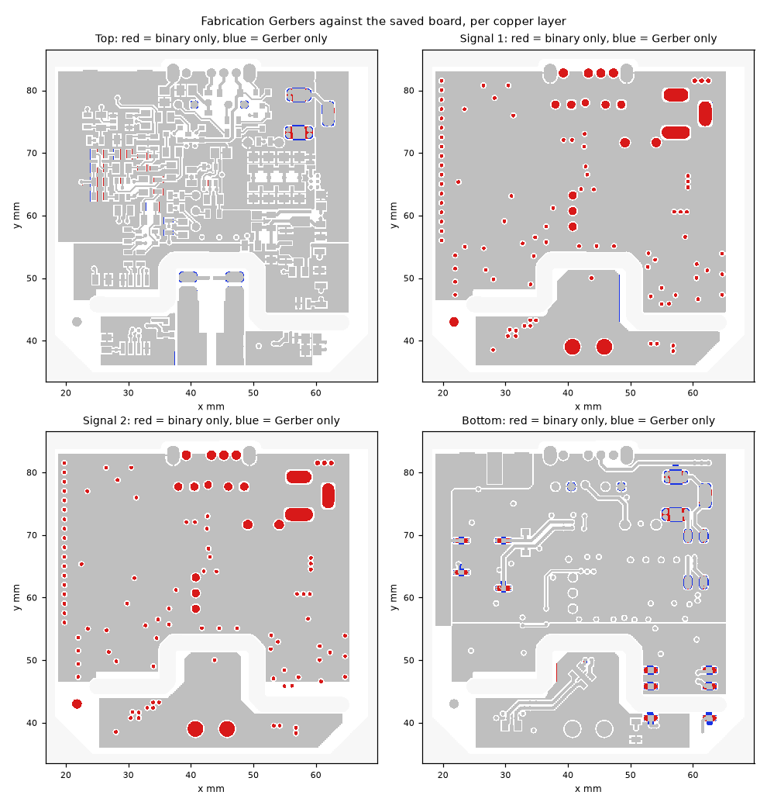
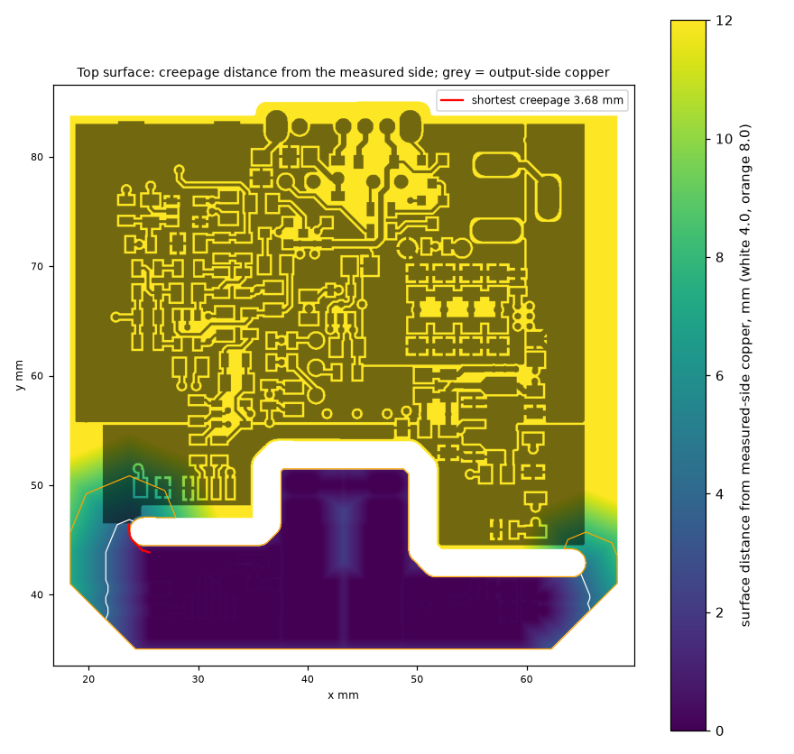
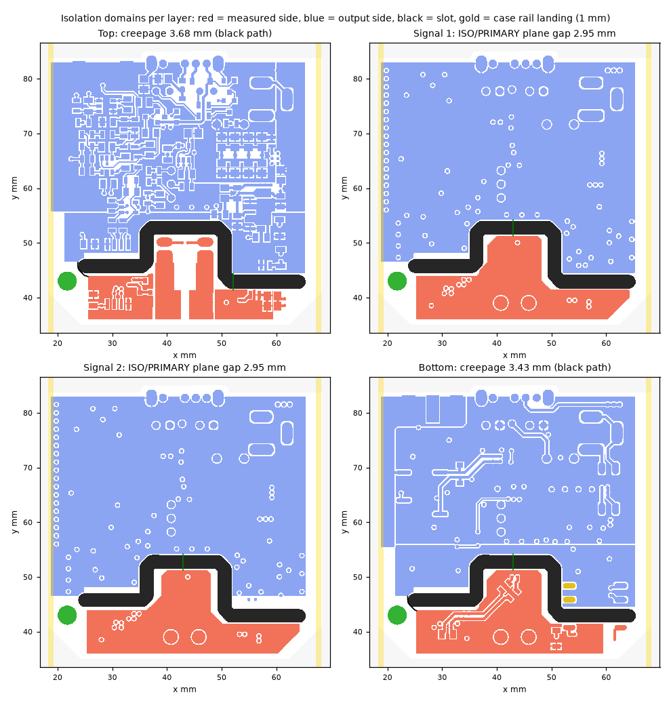
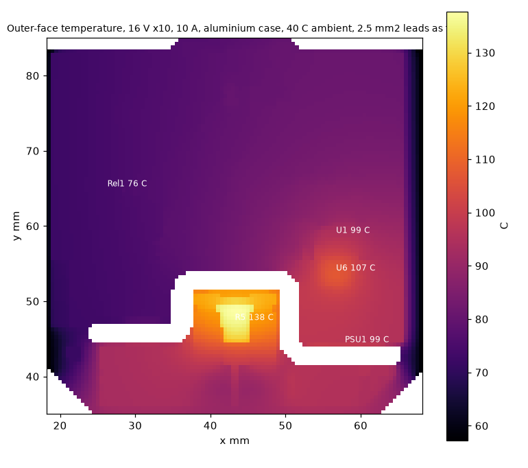
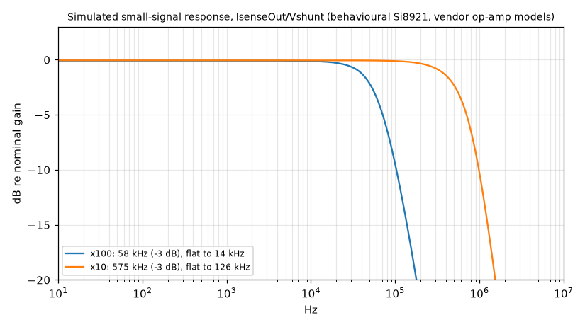
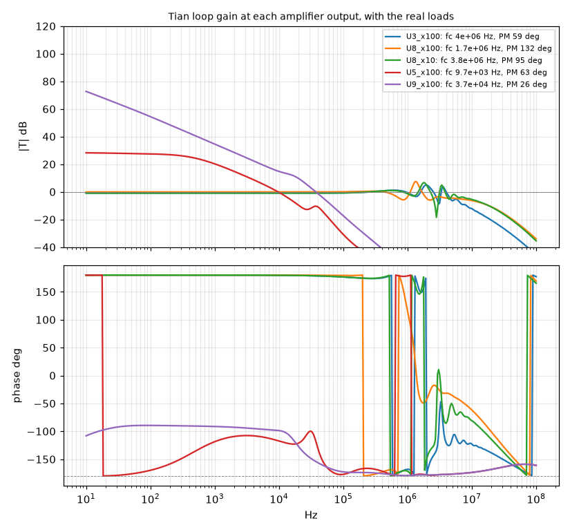
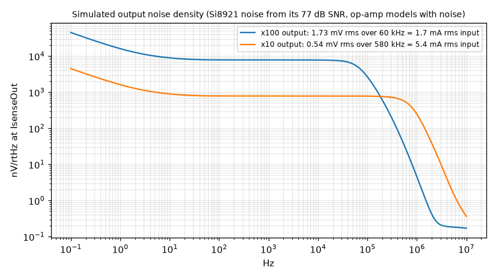
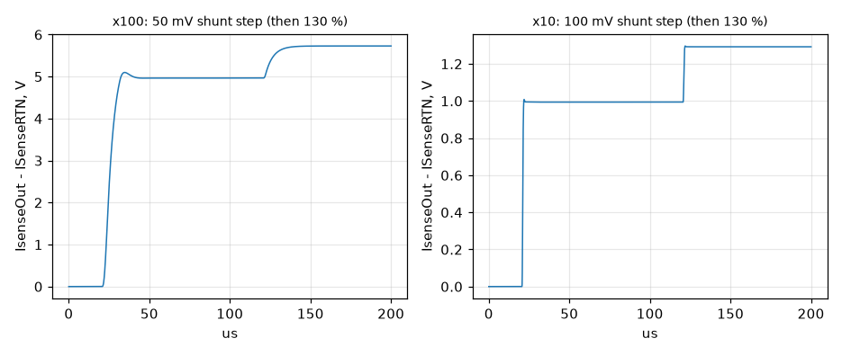
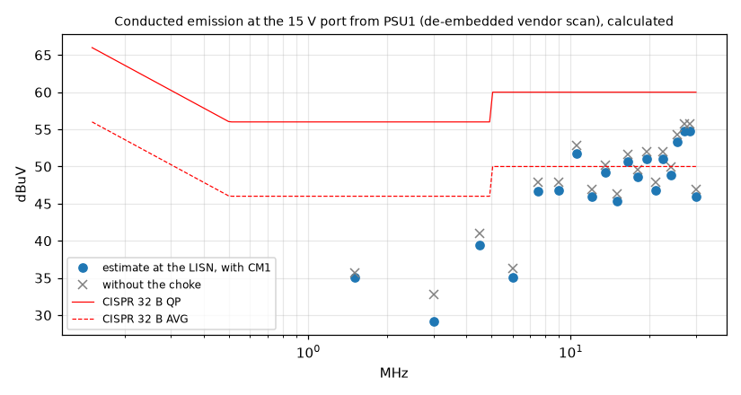

# Design review - MelansonTech Isolated Shunt Amplifier, Rev 3.1

**Review date:** 2026-10-29. **Generated** from `hardware/review/*.json` by `make_review.py`; every number below is read from a result file and marked **simulated**, **calculated** or **checked**.

| Board state reviewed |  |
|---|---|
| board | MelansonTech Isolated Shunt Amplifier Rev3.CSPcbDoc, saved 2026-08-20 20:37 (PDT) |
| sheets | Rev3 amplifier sheet 20:35, Rev3 PSU sheet 20:34, same day |
| outputs | Default Configuration/Outputs, written 2026-08-20 20:43 |
| commit | 512311d (2026-09-09), repository MelansonTech/Melanson-Tech-Isolated-Shunt-Amplifier, clone of 2026-10-28 |
| bench | one Rev 3.1 board characterised 2026-09-05/06 (docs/TEST_REPORT.md) |

Scope: the five gates that run on every review, then every area of the catalogue (isolation, power and rails, thermal, analog bias / loops / noise / bandwidth, EMC, DFM and the fabrication package, enclosure, sourcing and lifecycle, documentation). The schematic-level review of 2026-08-20 (`docs/DESIGN_REVIEW.md`, findings F1-F15) is carried in the register and re-examined where this run reaches further.

## Gates

| Gate | Verdict | What it found | Script |
|---|---|---|---|
| Outputs vs saved board | PASS | top 2.9 mm2 / bottom 11.7 mm2 of residual one-sided difference (distributed raster noise); inner layers differ only by the 68.5 mm2 of unused inner pads CircuitStudio removes from the Gerbers | gerber_vs_binary.py |
| Placement vs pick-and-place | PASS | 94 of 95 parts at their reference point; the P&P names R10 where the board's designator is blank (sync-2) | pnp_vs_board.py |
| BOM vs board | PASS* | 95 designators each way; the only miss is the unlinked R10 (sync-2); four comments differ (bom-1, bom-2) | bom_vs_board.py, comment_diff.py |
| Sheet vs board netlist | FAIL | 5 pins differ, all one part: R21 reversed and renamed 0 R on the sheet after the last ECO (sync-1); the committed sheets match the disk; at 053f1d7 the board matched | netlist_diff.py |
| Connectivity vs function | PASS | 11 interfaces, 42 pins, every pin reaches its target on sheet, board and HEAD except R28's wiper, which fails on the sheet only through the R21 reversal | connectivity_check.py |
| Pin constraints vs sheet | n/a | no programmable device |  |
| Port directions | n/a | two flat sheets joined by power ports and one port (HighGain); nothing to check | port_directions.py |
| Findings register | carried | 53 entries, 49 open | register.py |

*Fabrication Gerbers against the saved board, per copper layer (checked). Red is copper only in the binary, blue only in the Gerbers; the inner-layer red is the unused inner pads of vias and through-hole parts, which the output job strips.*

## Open findings, by severity

| Id | Sev | Area | Finding |
|---|---|---|---|
| F4 | 1 | legacy | R28 is 100 ohm on the schematic and CT94EW103 (10 k) in the BOM |
| sourcing-1 | 1 | sourcing | LM7321MF/NOPB (U5, U9): OBSOLETE |
| F11 | 2 | legacy | No reverse-polarity, fuse or TVS on the 15 V input; D6 clamp topology |
| F12 | 2 | legacy | SW1 carries the whole board supply at its 100 mA / 12 V rating |
| F13 | 2 | legacy | BOM lines C8, C43, R23 are generic placeholders |
| F15 | 2 | legacy | Rev 3.1 silkscreen legends disagree with the schematic |
| F2 | 2 | legacy | +12 rail unregulated below ~14.9 V at the jack |
| F5 | 2 | legacy | U6 HT7550-1 dissipates ~0.55-0.6 W in SOT-89 |
| analog-4 | 2 | analog | LM7321 bias current (0.4 uA typ, up to 2 uA) through the R21 asymmetry: 4 mV typ / 20 mV max offset between the two references with the board's 10 k, zero with the sheet's 0 R |
| bom-1 | 2 | bom | D6: sheet/BOM says BAS31, board says BAT54SLT1G |
| bom-2 | 2 | bom | R2: sheet/BOM says ERA-6VRW8201V, board says RR1220P-8251-D-M |
| bom-3 | 2 | bom | R9: sheet/BOM says ERA-6VRW8201V, board says RR1220P-8251-D-M |
| dfm-1 | 2 | dfm | Pours come within 0.21 mm of the barrier slot wall on every layer |
| dfm-2 | 2 | dfm | Barrier slot is drawn on the Outline layer as a 2.5 mm stroked path, not a closed cut-out contour |
| dfm-3 | 2 | dfm | A .GKO (keep-out) file with an 11.5 x 3.9 mm rectangle is in the fabrication set |
| emc-1 | 2 | emc | Conducted emission at the 15 V port from PSU1: worst margin -4.8 dB to CISPR 32 Class B AVG (10-30 MHz), module scan de-embedded |
| isolation-1 | 2 | isolation | Barrier creepage 3.43 mm (bottom) / 3.68 mm (top) around the slot's left end, below the 4.0 mm basic figure for 400 V |
| isolation-2 | 2 | isolation | Aluminium case rail (bonded to ISenseRTN) is 3.60 mm from PSU1's -Vout pad along the bottom surface at 1 mm groove engagement |
| isolation-3 | 2 | isolation | Free 3.5 mm plated hole at (21.75, 43.0) sits 2.1 mm from measured-side copper and 1.8 mm from output-side copper |
| isolation-4 | 2 | isolation | Pours on every layer come within 0.21 mm of the slot wall |
| isolation-5 | 2 | isolation | No design rule enforces the barrier |
| power-1 | 2 | power | x100 full scale (5.0 V) is at the output clamp at 13 V in: two Schottky drops plus the regulator dropout |
| power-2 | 2 | power | U6 (HT7550-1, SOT-89) dissipates 0.62 W at 15 V and 0.71 W at 16 V against a 0.5 W package rating |
| power-3 | 2 | power | SW1 carries 93-97 % of its 0.1 A rating at 15 V (rated 12 V) and makes/breaks the board supply |
| sourcing-2 | 2 | sourcing | G6L-1F DC12 (Rel1): conflicting |
| sourcing-3 | 2 | sourcing | PJ-002A (J4): conflicting |
| sourcing-4 | 2 | sourcing | DR331-105BE (CM1): conflicting |
| sourcing-5 | 2 | sourcing | CL31B475KBHNNNE (C11, C12): NRND (LCSC) |
| sync-1 | 2 | sync | Sheet and board differ: R21 is fitted the other way round and renamed on the sheet (0 ohm link) after the last ECO |
| sync-2 | 2 | sync | R10 exists on the sheets but the board's R10 footprint is not linked to it |
| thermal-1 | 2 | thermal | The slot makes the shunt area a thermal island: R5 at 10 A reaches 110 C in free air and 138 C in the case at 40 C with 2.5 mm2 leads as fins |
| F10 | 3 | legacy | Difference-amp CMRR relies on four discrete resistors |
| F14 | 3 | legacy | Relay contact resistance sits in the x100 gain network |
| F3 | 3 | legacy | R21 asymmetry between the two reference buffers (10 k vs 0) |
| F9 | 3 | legacy | C16, C17, C28 at 3 pF are below the layout parasitics |
| analog-1 | 3 | analog | U9_x100 loop: phase margin 26 deg (simulated, LM7321 model at its 10 V group) |
| analog-2 | 3 | analog | x100 bandwidth is set by C9 (47 nF) against the 50 ohm output resistors: simulated 58 kHz, measured 60 kHz |
| analog-3 | 3 | analog | Input-referred noise 1.7 mA rms (x100, 60 kHz) and 5.4 mA rms (x10, 580 kHz), dominated by the Si8921 |
| analog-5 | 3 | analog | D6 as drawn is an antiparallel clamp across AIP/AIN (+/-0.7 V with BAS31), not a series pair |
| dfm-4 | 3 | dfm | No fiducials and no test points on the board |
| documentation-1 | 3 | documentation | Documents give the board as 68.25 x 85.00 mm; it is 50.00 x 50.00 mm |
| documentation-2 | 3 | documentation | README says Revision 3 'has not been fabricated or tested' while the test report characterises a Rev 3.1 board |
| documentation-3 | 3 | documentation | The board file's stackup is not a fabricated one: 1.524 mm between top and the first plane, then 0.254 / 0.254 |
| documentation-4 | 3 | documentation | C7 is a 10 x 16 mm can (A750 MV); upright it cannot fit the 24 mm case, lying flat it clears by ~3 mm with 1.5 mm walls |
| documentation-5 | 3 | documentation | Rev 1 Bode files and the sheet note 'Circuit Requires 300mW' are stale |
| isolation-6 | 3 | isolation | J2's 400 V rating applies to overvoltage category II / pollution degree 2 only |
| power-4 | 3 | power | Relay coil at 16 V is 130 % of rating, within the G6L's 150 % maximum to 70 C |
| sourcing-6 | 3 | sourcing | Part numbers that no distributor listing matched: NXJ1S0505T6MC-R7, ERA-6VRW8201V, ERA-6AEB471V, C0805X102J1GACAUTO |
| thermal-2 | 3 | thermal | J2-to-shunt pours rise ~21 C at 10 A (IPC-2221, 1 oz, top layer only) |

## Isolation and safety

**Checked and simulated** (geometry from the board file, 0.05 mm raster; creepage as a geodesic on the surface inside the outline and around the slot). Standard figures are IEC 60664-1 and are assumptions until a clause is chosen: creepage at 400 V, pollution degree 2, material group IIIb = **4.0 mm basic / 8.0 mm reinforced** (5.0 mm at 500 V); clearance 1.5 mm for a 2.5 kV impulse, 3.0 mm for 4 kV. The DC-DC module is UL 62368-1 recognised to 400 Vrms basic / 200 Vrms reinforced with 4.0 mm of its own; the Si8921 wide-body package has 8.5 mm.

| Layer | Measured-side copper mm2 | Output-side copper mm2 | Straight gap in plane mm | Surface creepage mm | Copper to slot wall mm | Copper to outline mm |
|---|---|---|---|---|---|---|
| Top | 244.7 | 1246.0 | 3.100 | 3.680 | 0.212 | 0.550 |
| Signal 1 | 326.1 | 1521.2 | 2.950 | embedded | 0.212 | 0.500 |
| Signal 2 | 321.6 | 1498.4 | 2.950 | embedded | 0.212 | 0.550 |
| Bottom | 293.8 | 1431.8 | 2.950 | 3.430 | 0.212 | 0.550 |

The shortest surface path, 3.43 mm on the bottom and 3.68 mm on the top, runs from the GND_ISO / +5_ISO pours at [25.3, 43.86] round the slot's left end to the output-side +5 pour at [23.7, 46.51], which wraps 2.5 mm past the slot tip into the bridge. The 2.5 mm slot itself gives an in-plane air gap of 3.10 mm, which clears 400 V; the creepage does not.

*Top surface: distance along the surface from measured-side copper (simulated). The white contour is 4.0 mm, orange 8.0 mm; the red path is the shortest creepage.*

*The two domains per layer with the slot (black), the shortest paths and a 1 mm case-rail landing (gold).*

| Rail engagement mm | Creepage to the rail, bottom mm | Creepage to the rail, top mm | Straight line to the rail edge, bottom mm |
|---|---|---|---|
| 0.5 | 4.10 | 6.32 | 4.10 |
| 1.0 | 3.60 | 5.61 | 3.60 |
| 1.5 | 3.10 | 5.05 | 3.10 |
| 2.0 | 2.60 | 4.55 | 2.60 |

The aluminium case is bonded to ISenseRTN through the SMA nut, so its rails are output-side metal. The right-hand rail lands beside PSU1's -Vout pad: [63.7, 40.56] to [67.3, 40.56] on the bottom surface at 1 mm engagement. The free 3.5 mm plated hole at (21.75, 43.0) is 2.1 mm from measured-side copper and 1.8 mm from output-side copper on the top layer; PSU1's NC pins 12/14 are on the output side, 0.25 mm from its copper, which is fine because the datasheet says they are not connected internally.

## Power budget, rails and headroom

**Calculated**, sources named per line (`power_budget.py`): the module's input current is the residual of the measured 95.8 mA total, which implies 43 % module efficiency at its 137 mW load.

| Load | Rail | mA | Source | Basis |
|---|---|---|---|---|
| U3 | +12 | 1.00 | DS | OPA197 IQ 1.0 mA typ |
| U8 | +12 | 1.00 | DS | OPA197 IQ 1.0 mA typ |
| U5 | +12 | 1.35 | DS | LM7321 IS 1.35 mA typ |
| U9 | +12 | 1.35 | DS | LM7321 IS 1.35 mA typ |
| R22/R17 | +12 | 0.06 | CALC | 100k + 100k reference divider |
| R26/R28/R29 | +12 | 0.06 | CALC | 100k + 100 R + 100k trim divider |
| D4 or D5 | +12 | 0.88 | CALC | one blue LED through 10k, Vf 3.2 V (BOM description) |
| R13 | +12 | 0.60 | CALC | 10k from U3 out (~Vref) to GND, sourced by U3 |
| R15 | +12 | 0.60 | CALC | 10k from U8 out (~Vref) to GND, sourced by U8 |
| U1 | VregIn | 3.84 | DS | UA78L12 bias 3.84 mA typ (new chip) |
| U2 VDDB | +5 | 3.50 | DS | Si8921 output side 3.5 mA typ |
| PSU1 in | +5 | 63.26 | MEAS | residual of the measured 95.8 mA total at 15 V, x100 |
| R6 | +5_ISO | 22.73 | CALC | 220 R preload on the isolated 5 V |
| U2 VDDA | +5_ISO | 4.60 | DS | Si8921 input side 4.6 mA typ |
| U6 | VregIn | 0.00 | DS | HT7550-1 quiescent 2.5 uA |
| Rel1 coil | HighGain | 18.30 | CALC | G6L-1F DC12 coil 800 R at HighGain |

| Vin V | Range | VregIn V | +12 typ V | +12 guaranteed V | Headroom typ V | Headroom guaranteed V | Coil % | U6 W | SW1 % of 0.1 A |
|---|---|---|---|---|---|---|---|---|---|
| 13.0 | x10 | 12.64 | 10.94 | 10.14 | +4.17 | +3.77 | 0.0 | 0.51 | 77.3 |
| 13.0 | x100 | 12.28 | 10.58 | 9.78 | -0.01 | -0.41 | 105.3 | 0.49 | 93.0 |
| 14.0 | x10 | 13.64 | 11.94 | 11.14 | +4.67 | +4.27 | 0.0 | 0.58 | 77.5 |
| 14.0 | x100 | 13.28 | 11.58 | 10.78 | +0.49 | +0.09 | 113.7 | 0.55 | 94.5 |
| 15.0 | x10 | 14.64 | 12.00 | 12.00 | +4.70 | +4.70 | 0.0 | 0.64 | 77.5 |
| 15.0 | x100 | 14.28 | 12.00 | 11.78 | +0.70 | +0.59 | 122.0 | 0.62 | 95.8 |
| 15.6 | x10 | 15.24 | 12.00 | 12.00 | +4.70 | +4.70 | 0.0 | 0.68 | 77.5 |
| 15.6 | x100 | 14.88 | 12.00 | 12.00 | +0.70 | +0.70 | 127.0 | 0.66 | 96.6 |
| 16.0 | x10 | 15.64 | 12.00 | 12.00 | +4.70 | +4.70 | 0.0 | 0.71 | 77.5 |
| 16.0 | x100 | 15.28 | 12.00 | 12.00 | +0.70 | +0.70 | 130.3 | 0.69 | 97.1 |

Headroom is the output clamp (+12 less the 0.30 V the OPA197 output loses at its ~5 mA load, the figure the bench measured as 5.70 V above a 6.0 V reference) less the reference less full scale (5.0 V on x100, 1.0 V on x10). SW1's pole is terminal 2 (C&K: 1-2, 2-3, 2-4), so the x100 position feeds VregIn through D1 as well as D3. Regulation thresholds at the jack: x10 14.06 V typical / 14.86 V guaranteed, x100 14.42 / 15.22 V.

## Thermal

**Simulated**: 3-D finite difference at 0.5 mm on the rasterised copper of all four layers (`thermal.py`), JLC 4-layer stack, h = 10 W/m2K per face in free air, 5 W/m2K to the case interior plus the case to ambient at 12 W/m2K over its outer area, rails at 1500 W/m2K contact. Validation: a uniformly heated plate lands 2.4 % from P/(2hA) and every solve balances its input power. The 10 A leads are modelled as fins (2.5 mm2 copper, 3 mm OD) where stated; without them the shunt island has no path but convection.

| Load case | Enclosure | Ta C | P W | Case C | U6 C | R5 C | U2 C | PSU1 C | Rel1 C | U1 C |
|---|---|---|---|---|---|---|---|---|---|---|
| 15 V x100, 10 A | open | 25.0 | 2.36 | 25.0 | 77.4 | 192.7 | 148.5 | 151.2 | 58.1 | 70.3 |
| 15 V x100, 10 A | open | 40.0 | 2.36 | 40.0 | 92.4 | 207.7 | 163.5 | 166.2 | 73.1 | 85.3 |
| 15 V x100, 10 A | case | 25.0 | 2.36 | 42.9 | 94.0 | 311.7 | 265.6 | 268.3 | 70.6 | 86.9 |
| 15 V x100, 10 A | case | 40.0 | 2.36 | 57.9 | 109.0 | 326.7 | 280.6 | 283.3 | 85.6 | 101.9 |
| 15 V x100, 10 A | open+leads | 25.0 | 2.36 | 25.0 | 76.5 | 110.0 | 67.9 | 69.8 | 57.2 | 69.5 |
| 15 V x100, 10 A | open+leads | 40.0 | 2.36 | 40.0 | 91.5 | 125.0 | 82.9 | 84.8 | 72.2 | 84.5 |
| 15 V x100, 10 A | case+leads | 25.0 | 2.36 | 42.9 | 93.2 | 123.1 | 80.9 | 87.1 | 69.7 | 86.1 |
| 15 V x100, 10 A | case+leads | 40.0 | 2.36 | 57.9 | 108.2 | 138.1 | 95.9 | 102.1 | 84.7 | 101.1 |
| 16 V x10, 10 A | open | 25.0 | 2.17 | 25.0 | 76.8 | 192.5 | 148.2 | 151.0 | 48.8 | 68.7 |
| 16 V x10, 10 A | open | 40.0 | 2.17 | 40.0 | 91.8 | 207.5 | 163.2 | 166.0 | 63.8 | 83.7 |
| 16 V x10, 10 A | case | 25.0 | 2.17 | 41.4 | 92.9 | 310.1 | 263.9 | 266.6 | 62.3 | 84.8 |
| 16 V x10, 10 A | case | 40.0 | 2.17 | 56.4 | 107.9 | 325.1 | 278.9 | 281.6 | 77.3 | 99.8 |
| 16 V x10, 10 A | open+leads | 25.0 | 2.17 | 25.0 | 76.0 | 110.0 | 67.7 | 69.0 | 48.0 | 67.9 |
| 16 V x10, 10 A | open+leads | 40.0 | 2.17 | 40.0 | 91.0 | 125.0 | 82.7 | 84.0 | 63.0 | 82.9 |
| 16 V x10, 10 A | case+leads | 25.0 | 2.17 | 41.4 | 92.1 | 122.7 | 80.4 | 84.4 | 61.4 | 84.0 |
| 16 V x10, 10 A | case+leads | 40.0 | 2.17 | 56.4 | 107.1 | 137.7 | 95.4 | 99.4 | 76.4 | 99.0 |
| 15 V x100, 0 A | open | 25.0 | 1.36 | 25.0 | 76.3 | 44.4 | 55.1 | 69.5 | 56.9 | 69.2 |
| 15 V x100, 0 A | open | 40.0 | 1.36 | 40.0 | 91.3 | 59.4 | 70.1 | 84.5 | 71.9 | 84.2 |
| 15 V x100, 0 A | case | 25.0 | 1.36 | 35.4 | 85.6 | 68.5 | 67.9 | 79.5 | 62.1 | 78.5 |
| 15 V x100, 0 A | case | 40.0 | 1.36 | 50.4 | 100.6 | 83.5 | 82.9 | 94.5 | 77.1 | 93.5 |

*Outer-face temperature, 16 V on x10 with 10 A through the shunt, aluminium case at 40 C ambient, leads as fins (simulated).*

With the board file's own stackup (1.524 mm core under the top layer) the worst-case board maximum rise is 159 C instead of 98 C, which is why the fabricated stack matters and is listed as a documentation item.

## Analog: bandwidth, bias, noise, loop stability, step

**Simulated** with the vendor OPA197 and LM7321 models (validated at 12 V in `sim/validate_models.py`: OPA197 Vos 19 uV, GBW 10.1 MHz, Iq 1.60 mA against 25 uV / 10 MHz / 1.0 mA typical; LM7321 10 V group Vos -1.72 mV, Ib -1.12 uA, GBW 9.1 MHz against +/-0.35 mV / 0.4 uA / 24 MHz - the model's bandwidth at this supply is low and its output swing optimistic, so the measured 0.30 V clamp is used for headroom) and a behavioural Si8921 from datasheet Table 5 (behavioural, Table 5: gain 8.2, two real poles (-3 dB 600 kHz), delay 0.80 us total, Vocm 1.39 V, clip 2.5 V diff, noise 79 nV/rtHz). Capacitors on the references are DC-bias derated (C30 17 uF, C29 13 uF).

| Range | Gain | -3 dB kHz (sim) | -3 dB kHz (bench) | 0.1 dB kHz | 1 dB kHz |
|---|---|---|---|---|---|
| x100 | 99.14 | 57.5 | 60 | 14.5 | 38.0 |
| x10 | 9.94 | 575.4 | 580 | 125.9 | 354.8 |

*Small-signal response of the chain for both ranges (simulated).*

| Loop | Crossover Hz | Phase margin deg | Gain margin dB |
|---|---|---|---|
| U3_x100 | 3.99e+06 | 59.1 | 42.8 |
| U8_x100 | 1.68e+06 | 132.2 | 29.9 |
| U8_x10 | 3.82e+06 | 95.5 | 29.0 |
| U5_x100 | 9.68e+03 | 63.2 | 60.9 |
| U9_x100 | 3.74e+04 | 25.9 | - |

*Tian loop gain at each amplifier output with the board's loads (simulated).*

| Range | Output density at 1 kHz nV/rtHz | Output rms over the band mV | Input-referred mA rms | Band kHz |
|---|---|---|---|---|
| x100 | 7885.9 | 1.732 | 1.73 | 60.0 |
| x10 | 790.5 | 0.544 | 5.44 | 580.0 |

*Output noise density (simulated); the Si8921's share is its 77 dB SNR as a white source.*

| Range | Step mV | Final V | Rise 10-90 us | Delay us | Overshoot % | Settle 0.1 % us | 130 % step V |
|---|---|---|---|---|---|---|---|
| x100 | 50.0 | 4.965 | 7.15 | 5.17 | 2.70 | 22.7 | 5.729 |
| x10 | 100.0 | 0.994 | 0.60 | 1.09 | 1.45 | 2.9 | 1.292 |

*Full-scale step on each range, then 130 % of full scale (simulated; the clamp level reflects the model's optimistic swing).*

| +12 V | Range | Vshunt V | R21 | ISenseRTN V | DiffAmpRef-ISenseRTN mV | U3 out V | U8 out V | Output V | I(+12) mA |
|---|---|---|---|---|---|---|---|---|---|
| 12.0 | x100 | +0.000 | 0 | 6.054 | -0.05 | 6.054 | 6.054 | +0.0001 | 5.71 |
| 12.0 | x100 | +0.000 | 10000 | 6.054 | +11.08 | 6.065 | 6.166 | +0.1113 | 5.80 |
| 12.0 | x100 | +0.050 | 0 | 6.054 | -0.30 | 6.551 | 11.019 | +4.9642 | 9.46 |
| 12.0 | x100 | -0.050 | 0 | 6.054 | +0.19 | 5.557 | 1.090 | -4.9640 | 8.20 |
| 12.0 | x10 | +0.000 | 0 | 6.054 | -0.05 | 6.054 | 6.054 | +0.0000 | 5.71 |
| 12.0 | x10 | +0.000 | 10000 | 6.054 | +11.11 | 6.065 | 6.065 | +0.0112 | 5.72 |
| 12.0 | x10 | +0.100 | 0 | 6.054 | -0.05 | 7.048 | 7.048 | +0.9939 | 5.97 |
| 12.0 | x10 | -0.100 | 0 | 6.054 | -0.06 | 5.060 | 5.060 | -0.9939 | 5.46 |
| 10.6 | x100 | +0.000 | 0 | 5.354 | -0.05 | 5.354 | 5.354 | +0.0001 | 5.46 |
| 10.6 | x100 | +0.000 | 10000 | 5.354 | +11.09 | 5.365 | 5.466 | +0.1114 | 5.54 |
| 10.6 | x100 | +0.050 | 0 | 5.354 | -0.29 | 5.851 | 10.319 | +4.9643 | 9.20 |
| 10.6 | x100 | -0.050 | 0 | 5.354 | +0.20 | 4.857 | 0.390 | -4.9640 | 8.01 |
| 10.6 | x10 | +0.000 | 0 | 5.354 | -0.05 | 5.354 | 5.354 | +0.0000 | 5.46 |
| 10.6 | x10 | +0.000 | 10000 | 5.354 | +11.12 | 5.365 | 5.365 | +0.0112 | 5.46 |
| 10.6 | x10 | +0.100 | 0 | 5.354 | -0.04 | 6.348 | 6.348 | +0.9939 | 5.71 |
| 10.6 | x10 | -0.100 | 0 | 5.354 | -0.05 | 4.360 | 4.360 | -0.9939 | 5.20 |

Bias (**simulated**): at the 10.6 V rail (13 V in on x100) every amplifier still sits inside its input range; what runs out is the output swing at full scale, as the rails table shows. The DiffAmpRef-ISenseRTN difference is the LM7321 model's offset and bias current acting on the two dividers, and it doubles with the board's 10 k R21.

## EMC

**Calculated**, module only (`emc_conducted.py`): PSU1's harmonics as de-embedded from Murata's conducted scan in the FTCAN review (same module, 1.5 MHz), as common-mode current through the 2.5 pF barrier, against CISPR 32 Class B DC-port limits. CM1 (1 mH) attenuates -0.6 dB at 1.5 MHz against a 40 kohm source. Worst margin -4.8 dB to the average limit. The Si8921 modulator has no vendor scan and the measured circuit's earth path is unknown; a LISN scan decides.

*Conducted emission estimate at the 15 V port (calculated).*

## DFM and the fabrication package

**Checked** (`dfm_check.py`): narrowest copper {'1': 0.25, '32': 0.254} mm per layer against a 0.130 mm rule; closest different-net copper {'Top': '0.200 (NetR10_1)', 'Signal 1': '0.206 (NetL3_2)', 'Signal 2': '0.206 (NetL3_2)', 'Bottom': '0.206 (NetL3_2)'}; copper to the slot wall 0.21 mm on every layer against JLC's 0.30 mm routed-edge figure; annular rings at or above 0.15 mm (vias 0.6/0.3); the drill `.TXT` reconciles hole for hole (160 round holes plus 3 slots against 163 on the board); no fiducials, no test points.

| Sev | Finding |
|---|---|
| 2 | Pours come within 0.21 mm of the barrier slot wall on every layer |
| 2 | Barrier slot is drawn on the Outline layer as a 2.5 mm stroked path, not a closed cut-out contour |
| 2 | A .GKO (keep-out) file with an 11.5 x 3.9 mm rectangle is in the fabrication set |
| 3 | No fiducials and no test points on the board |
| 3 | J2-to-shunt pours rise ~21 C at 10 A (IPC-2221, 1 oz, top only) |

## Enclosure

**Calculated** (`enclosure_fit.py`): the board's mid-plane sits 8.75 mm above the panel bottom (the SMA cutout), bottom side up. With 1.5 mm walls (assumed; the case has no drawing) there is 12.95 mm above the bottom side and 6.45 mm above the top side.

| Part | Side | Height mm | Margin mm | Source |
|---|---|---|---|---|
| C7 standing | BOTTOM | 16.0 | -3.05 | a750.pdf: MV size code = 10 x 16 mm can; if mounted upright |
| J4 | BOTTOM | 11.0 | +1.95 | pj-002a.pdf drawing, 11.00 |
| J2 | BOTTOM | 10.5 | +2.45 | EST: BCH-508HS 2-pos header, through Panel B cutout 9.5 mm tall |
| C7 lying (RA1) | BOTTOM | 10.0 | +2.95 | a750.pdf: 10 mm diameter; the footprint name (RA1) implies a right-angle, lying mount |
| U2 | TOP | 2.8 | +3.65 | board file HEIGHT 2.8 |
| D4/D5 | BOTTOM | 9.0 | +3.95 | panel LED holes at Y 18.0: leads formed to reach the panel, EST |
| Q5/Q6 | TOP | 2.4 | +4.05 | board file HEIGHT 2.38 |
| U1/U6 | TOP | 2.0 | +4.45 | board file HEIGHT 2.0 |
| C11/C12 | TOP | 1.6 | +4.85 | EST: 1206 4.7 uF 50 V |
| C1 (0805 HD) | TOP | 1.4 | +5.05 | board file HEIGHT 1.4 |
| CM1 | BOTTOM | 5.0 | +7.95 | board file HEIGHT 5.0 |
| R28 | BOTTOM | 5.0 | +7.95 | EST: CT-94 top-adjust body |
| SW1 | BOTTOM | 4.7 | +8.25 | os103011.pdf: frame H = 4.7 mm; actuator passes through the panel slot |
| Rel1 | BOTTOM | 4.2 | +8.75 | g6l.pdf G6L-1F drawing 4.2 +/-0.2 |
| PSU1 | BOTTOM | 4.0 | +8.95 | board file HEIGHT 4.0 |

## Sourcing and lifecycle (web check 2026-10-29)

| Ref | Part | Status | Source | Stock / price |
|---|---|---|---|---|
| U5, U9 | LM7321MF/NOPB | OBSOLETE | ti.com part details 2026-10-29: 'no longer in production'; Digi-Key: 'Obsolete and no longer manufactured' | TI none; Digi-Key none; LCSC 76 'discontinued' / None |
| Rel1 | G6L-1F DC12 | conflicting | Omron KR snippet 'In production'; Digi-Key CA 'Active' but no backorders, 'temporary constrained supply'; Mast | Digi-Key 0; Mouser ~5,220 (snippet); Master 639 / Mouser ~$1.78 (snippet) |
| J4 | PJ-002A | conflicting | Master Electronics 'no longer being manufactured ... End of Life' (template wording); Same Sky page did not re | Master 31,656; Future 24,730 / Master $0.412 @100 |
| CM1 | DR331-105BE | conflicting | Digi-Key CA 'Active', non-cancellable; Master Electronics 'no longer being manufactured' (template wording); O | Digi-Key 0 (1,500 est. 2027-04-15, 16 wk); Master 4,887 / Master $0.5085 @500 |
| C11, C12 | CL31B475KBHNNNE | NRND (LCSC) | LCSC snippet 'Not recommended for new designs'; Samsung page HTTP 500 | LCSC 86,430; Future 380,000 (40 wk) / LCSC from $0.0188 |

Every other line read Active at a distributor or could not be verified; the full table is `hardware/review/sourcing.json`.

## The 2026-08-20 findings, re-examined

| Id | Status | Finding | This run |
|---|---|---|---|
| F1 | closed | Isolated auxiliary supply requirement was undocumented | ISenseRTN is bonded to chassis and board GND floats 6 V below it; an earthed supply shorts U5. README, CONNECTORS.md and the Rev 3.1 silkscreen now state it. Th |
| F2 | open | +12 rail unregulated below ~14.9 V at the jack | UA78L12 needs 14.5 V in; one Schottky on the x10 range. Headroom on the 5 A range shrinks to 0.32 V at 13 V. Re-examined in this review with both diode drops on |
| F3 | open | R21 asymmetry between the two reference buffers (10 k vs 0) | Recommended 100 ohm. The sheets now carry R21 = 0 ohm (CR0805-J/-000ELF); the board still carries CRCW080510K0FKTA (10 k) - see sync-1. |
| F4 | open | R28 is 100 ohm on the schematic and CT94EW103 (10 k) in the BOM | A 10 k trimmer resolves to 5.7 % of full scale on the x100 range. BOM line unchanged in the 2026-08-20 Rev 3 output. |
| F5 | open | U6 HT7550-1 dissipates ~0.55-0.6 W in SOT-89 | Drops VregIn to 5 V for the Si8921 output side and the DC-DC module. Total board draw measured 95 mA; U6 share and junction temperature not measured. Re-examine |
| F6 | closed | Published common-mode figure exceeded the J2 400 V connector rating | Corrected to 400 Vdc in the documentation; creepage and clearance were never checked on the layout. Re-examined in this review. |
| F7 | closed | Accuracy stack-up: +/-(1.0 % + 12 mA) and +/-(0.9 % + 8 mA) | Hybrid worst case; bench 2026-09-06 measured -0.24 % and -0.05 % gain error on one board. |
| F8 | closed | x100 bandwidth not derivable from the schematic | Measured 60 kHz on Rev 3.1. This review derives it: 50 ohm (R4||R8) with C9 47 nF switched in by Q6 gives 67.7 kHz, 63 kHz with C18 in parallel. |
| F9 | open | C16, C17, C28 at 3 pF are below the layout parasitics | Set nothing repeatable; raise or delete. |
| F10 | open | Difference-amp CMRR relies on four discrete resistors | R2/R9 8.2 k 0.05 % and R3/R20 10 k 0.1 %; a matched network would remove the drift term. |
| F11 | open | No reverse-polarity, fuse or TVS on the 15 V input; D6 clamp topology | C7 (1000 uF polymer) reverse-biased by a centre-negative adapter. D6 is an antiparallel pair across AIP/AIN (not a series pair) - see protection-1. |
| F12 | open | SW1 carries the whole board supply at its 100 mA / 12 V rating | Confirmed from the netlist in this review: pole pin 2 fed by D3, positions 3 and 4 carry VregIn and HighGain. 95 mA measured at 15 V. |
| F13 | open | BOM lines C8, C43, R23 are generic placeholders | 680 pF, 680 pF and 1 ohm on the sheet; no part number in the 2026-08-20 Rev 3 BOM. |
| F14 | open | Relay contact resistance sits in the x100 gain network | ~100 mohm in series with 156.7 ohm: 0.06 % initially, a wear-out term. |
| F15 | open | Rev 3.1 silkscreen legends disagree with the schematic | x50 fixed to x100 (2026-08-21); Vout settled at 5.70 V measured. Still open: Supply 13-16Vdc against the 12 V relay coil (15.6 V max), Max Input +/-200mV agains |

## Inputs, models and what was assumed

Datasheets read in this session are in `hardware/review/datasheets/` (24 files; `ds_params.py` names the table or page behind each number). Models: TI OPA197.LIB (2019), the National LM7321.MOD with its 10 V group active, a behavioural Si8921, no model for the UA78L12 (TI publishes only the 5 V variant) or the HT7550-1. Assumed: IEC 60664-1 figures at PD2 / group IIIb / OVC II; the JLC stackup; 1.5 mm case walls and 1 mm rail engagement; 2.5 mm2 leads; X5R DC-bias derating from a fitted class-2 curve; the module's harmonics from Murata's scan; h = 10 / 5 / 12 W/m2K.

Not assessable here: the real shunt temperature at 10 A (needs a measurement with the leads used), the conducted scan, the creepage clause the product will claim, the case section (wall thickness, groove depth).
