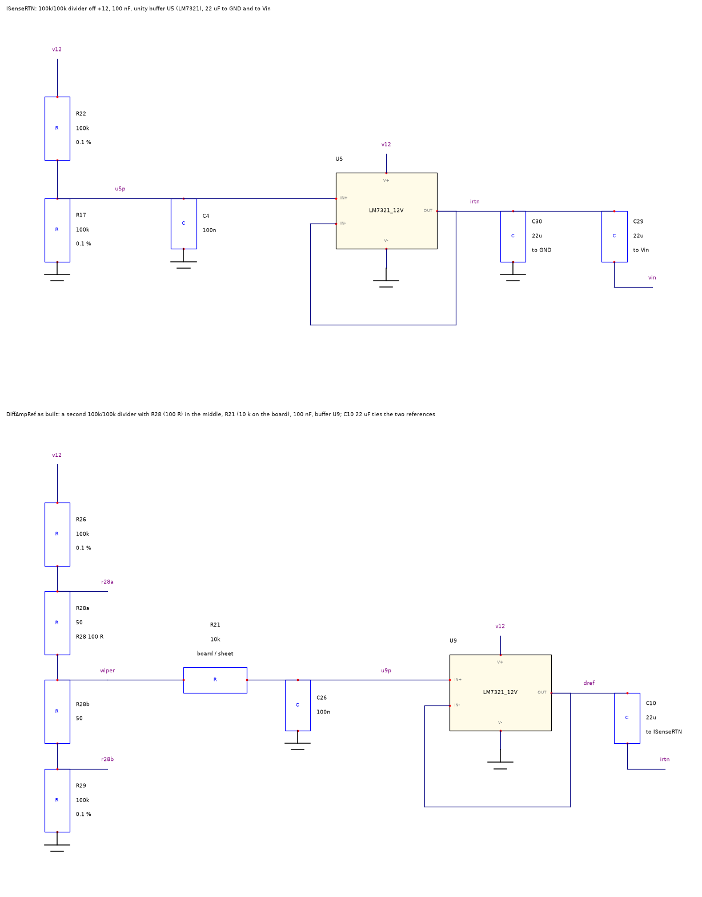
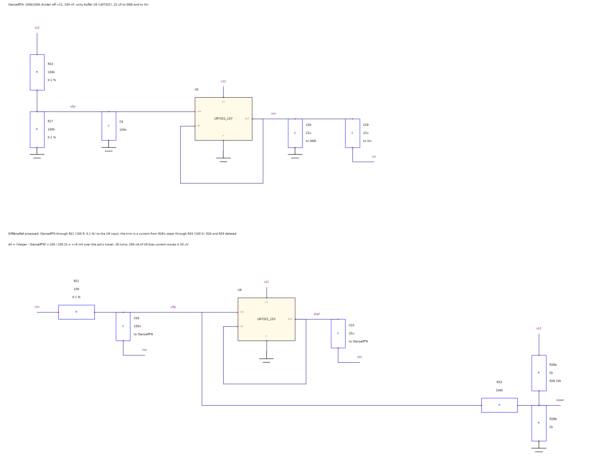
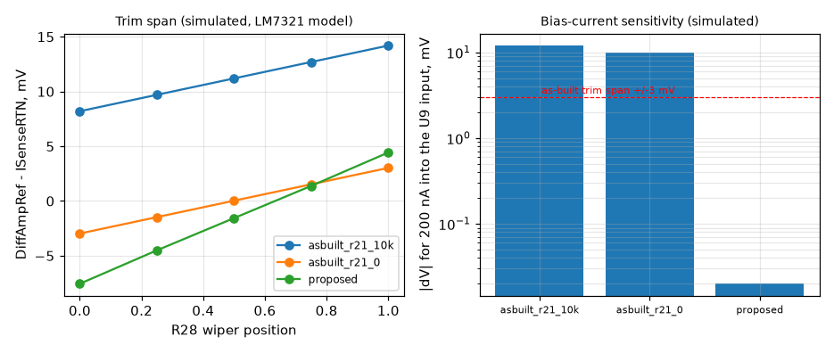

# Single-source reference trim

Recommendation 1 of the 2026-10-29 review, drawn and simulated. The two 6 V references (ISenseRTN, the chassis-bonded output return, and DiffAmpRef, the zero trim) are today generated by two separate 100 k / 100 k dividers and two buffers, with the trimmer in the second divider. The proposal keeps the first divider and buffer exactly as built and derives DiffAmpRef from ISenseRTN itself: a 100 Ω resistor in series, and the trim as a small current injected into that node from the existing 10 k trimmer through 100 k. Every number below is read from `hardware/review/sim/ref_trim.json`, written by `ref_trim.py`; the schematics are `ref_asbuilt.asc` and `ref_proposed.asc`, each netlisted by LTspice and compared element by element with the bench that produced the numbers.

## As built

*Rev 3.1 reference section as built: two dividers, R28 (100 Ω) inside the second, R21 between the wiper and U9 (10 k on the board, 0 Ω on the sheet), C26 to GND.*

The weakness is not the dividers' tolerance, which the trim removes, but the two buffers' input currents working into two different impedances. An LM7321 input draws 0.4 µA typical (up to 2 µA), and the two inputs differ by up to 200 nA. Into the second divider's 50 kΩ that difference is a 10 mV shift between the references, more than the ±3 mV the trimmer spans, and its drift with temperature is not specified. With the board's 10 k R21 the model puts the whole span 11.2 mV off zero.

## Proposed

*Proposed: ISenseRTN through R21 (100 Ω, 0.1 %) to the U9 input; R33 (100 k) injects the trim current from the wiper of R28 (10 k across +12 and GND); C26 returns to ISenseRTN; R26 and R29 are deleted.*

DiffAmpRef = ISenseRTN + (V_wiper − ISenseRTN) × 100 / 100.1 k. Everything that moves ISenseRTN (the +12 rail, R22/R17, U5's offset and bias current) moves DiffAmpRef with it and drops out of the difference. What is left in the difference is U9's own offset and bias current into 100 Ω, and the trim network.

## What the simulation shows

| Circuit | Trim span, mV | Mid-travel offset, mV | 200 nA into the U9 input | Rail ±0.5 V at full trim | U9 loop margin |
|---|---|---|---|---|---|
| as built, R21 = 10 k (board) | 8.2 to 14.2 | 11.20 | 12.0 mV | ±125 µV | 39° at 28 kHz |
| as built, R21 = 0 (sheet) | -3.0 to 3.0 | 0.03 | 10.0 mV | ±125 µV | 39° at 28 kHz |
| proposed | -7.6 to 4.4 | -1.56 | 20 µV | ±266 µV | 43° at 18 kHz |

**Simulated**, LM7321 vendor model at its 10 V group (its offset is −1.6 mV and its bias current −1.1 µA, both inside the datasheet limits, which is why the proposed span sits off-centre: that is the single buffer's offset showing, and it is what the trim is for). The as-built spans are ±3 mV; the proposed span is ±6 mV, chosen so that one buffer's full ±5 mV datasheet offset is inside it, where the as-built ±3 mV cannot cover two buffers' ±5 mV each (CALIBRATION.md already allows for fitting a 200 Ω trimmer when it will not null). The U9 loop sees the same 22 µF load and its margin does not move.

*Trim span against wiper position for the three cases, and the shift produced by 200 nA of bias-current imbalance at the U9 input (simulated).*

## Drift of the reference difference, from the datasheets

| Term (at the reference node) | As built, R21 = 0 | Proposed |
|---|---|---|
| Buffer offset drift, 2.5 µV/°C typ each | 5.0 µV/°C (two buffers) | 2.5 µV/°C (one buffer) |
| IOS maximum × source impedance, static | 10.0 mV (50 k) | 20 µV (100 Ω) |
| Bias-current movement over temperature (20 % of typical) | 0.8 mV with 10 k R21; IOS drift unspecified | 8 µV |
| Trim resistors, 125 ppm/°C at full 6 mV trim | about the same (the divider's R28 and R21) | 0.75 µV/°C |
| Referred to the shunt (÷10) over ±20 °C | up to 0.25 % of 100 mV, unspecified | about 0.006 % |

After the change the reference difference is no longer in the budget; the Si8921's own 3 µV/°C maximum (60 µV over ±20 °C, 0.06 % of the 10 A range's full scale) is the next term and the one the isolator choice addresses.

## BOM and sheet changes

| Ref | As built | Proposed | Note |
|---|---|---|---|
| R26, R29 | 100 k 0.1 % | deleted | the second divider |
| R28 | CT94EW103 10 k in the BOM, 100 Ω fitted | CT94EW103 10 k, across +12 and GND | the BOM line becomes correct; 1.2 mA, 14 mW on a 0.5 W trimmer |
| R21 | 10 k (board) / 0 Ω (sheet), wiper to U9 | 100 Ω 0.1 % 25 ppm, ISenseRTN to the U9 input | same series as R17/R22 |
| R33 | - | 100 k 1 %, wiper to the U9 input | new; its tolerance only scales the span |
| C26 | 100 nF to GND | 100 nF to ISenseRTN | damps the wiper into the node; the pole is 16 kHz, the as-built 26 Hz filter is no longer needed because ISenseRTN's noise is common to both references |
| U5, U9 | LM7321MF/NOPB (obsolete) | unchanged by this proposal | the part choice is recommendation 2 |
| R22, R17, C4, C10, C29, C30 | as built | unchanged |  |

On the amplifier sheet: move R28's ends from R26/R29 to +12 and GND, replace R21's left end (the wiper) with ISenseRTN, add R33 from the wiper to the U9 non-inverting input, return C26 to ISenseRTN, delete R26 and R29. No board outline, connector or range change.

## Not changed by this

Noise (the Si8921 dominates), bandwidth, the isolation geometry, the reference absolute level (ISenseRTN still sits at +12 / 2 and moves with the rail, which the matched architecture tolerates), and the trim's proportionality to the rail (a ±0.5 V rail change moves a full 6 mV trim by ±266 µV, the same 4 % as today).
